# PostEulen.de – Architektur v0.1

> Stand: Schritt P (2026-11-05). Grundlage ist `SPEC.md`; Verweise wie „(5.8)“ meinen deren Abschnitte. Entscheidungen, die die SPEC offenlässt, stehen mit Begründung in `DECISIONS.md` (Verweise „D-xx“). Antworten auf die Fragen aus Schritt P: `DECISIONS.md`, Teil C.

---

## 1. Komponenten

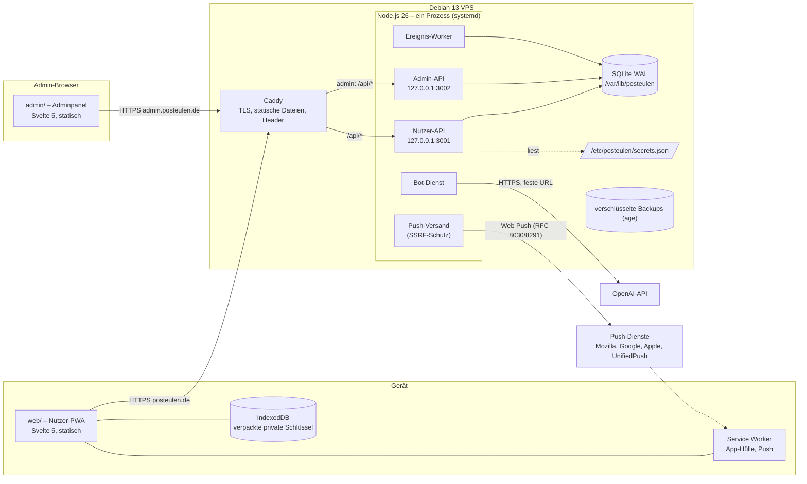

| Komponente | Ordner | Aufgabe |
|---|---|---|
| Nutzer-PWA | `web/` | Oberfläche, gesamte Client-Kryptografie, Karte (Anzeige), Service Worker |
| Adminpanel | `admin/` | Oberfläche für die Admin-API (13) |
| Backend | `backend/` | Fastify-Server mit zwei getrennten Listenern (Nutzer-API und Admin-API, eigene Routen, eigene Cookies), Datenbank und Migrationen, Ereignis-Warteschlange, Spielregeln, Bots, Push, Kommandozeilenbefehle (Setup, Admin-Reset, Backup) |
| Shared | `shared/` | Typen, Valibot-Schemas, Konstanten (Anhang A, B, D, E), Texte (`texts/de.ts`, v0.4 zusätzlich `texts/en.ts` und je Sprache Hilfe, Rechtstexte, Bot-Briefe, Systemtexte), Krypto-Formate, reine Spiellogik (Flug, Energie, Gold, Wahrscheinlichkeiten, Namens-Normalisierung, Textregeln), Land/Wasser-Maske |
| Betrieb | `deploy/` | `install.sh`, `update.sh`, Caddyfile-Vorlage, systemd-Units, Backup-Skript, VM-Testumgebung |
| Bilder | `images/` | Originale (PNG); der Build erzeugt daraus WebP-Varianten in `web/dist` |

**Ein Prozess, zwei Listener (D-12):** Nutzer-API und Admin-API laufen im selben Node-Prozess, lauschen aber auf getrennten localhost-Ports und haben getrennte Router, Cookies und Rate-Limits. Caddy leitet `posteulen.de/api/*` an 3001 und `admin.posteulen.de/api/*` an 3002. Damit ist eine Admin-Route über die Nutzer-Domain gar nicht erreichbar und umgekehrt. Statische Dateien liefert Caddy direkt aus.

**Backend ohne Build-Schritt (D-04):** Node.js 26 führt TypeScript per eingebautem Type-Stripping direkt aus (nur „erasable syntax“, erzwungen per `erasableSyntaxOnly`). Die Typprüfung läuft mit `tsc --noEmit`. Gebaut werden nur `web/` und `admin/` (Vite).

---

## 2. Krypto-Formate

### 2.1 Bausteine

| Zweck | Verfahren | Bibliothek |
|---|---|---|
| Anmeldung | OPAQUE (RFC 9807), ristretto255, Argon2id m = 64 MiB, t = 3, p = 4 | `@serenity-kit/opaque` 1.1.0 (opaque-ke 4.0.0) |
| Schlüsselableitung | HKDF-SHA256 (RFC 5869), leeres Salt, `info` = Kontext-String | **WebCrypto** `crypto.subtle` (D-02) |
| Symmetrisch | XChaCha20-Poly1305-IETF, 24-Byte-Zufallsnonce | libsodium (`libsodium-wrappers-sumo`) |
| Signatur | Ed25519 (detached) | libsodium |
| Brief-Schlüssel verteilen | HPKE Base, DHKEM(X25519, HKDF-SHA256), HKDF-SHA256, ChaCha20-Poly1305 | `@hpke/core` + `@hpke/dhkem-x25519` + `@hpke/chacha20poly1305` |
| Padding | ISO/IEC 7816-4 | libsodium `sodium.pad` |
| Lokale Verpackung | AES-256-GCM, nicht exportierbarer `CryptoKey` | WebCrypto |
| Hashes und HMAC (Server) | SHA-256, HMAC-SHA256 | `node:crypto` |

### 2.2 Kontext-Strings (alle in `shared/crypto/contexts.ts`)

| Kontext | Verwendung |
|---|---|
| `PostEulen/master-key-wrap/v1` | HKDF(export_key) → Verpackungsschlüssel des Hauptschlüssels (5.4) |
| `PostEulen/identity-keys/v1` | HKDF(Hauptschlüssel) → Schlüssel für die privaten Identitätsschlüssel |
| `PostEulen/contact-vault/v1` | HKDF(Hauptschlüssel) → Tresor-Schlüssel |
| `PostEulen/letter-sig/v1` | Präfix der Brief-Signatur (5.8) |
| `PostEulen/letter-ad/v1` | Präfix der Associated Data eines Briefs |
| `PostEulen/letter-key/v1` | Präfix des HPKE-`info` (plus Brief-ID und Rolle `recipient`/`sender`) |
| `PostEulen/safety-number/v1` | Präfix der Sicherheitsnummer |
| `PostEulen/server/…/v1` | Ableitungen aus dem Wurzelgeheimnis (2.5) |

### 2.3 Kanonische Kodierung

Alle signierten oder als Associated Data verwendeten Strukturen werden **binär und eindeutig** kodiert (`shared/crypto/encoding.ts`): Kontext-String, dann jedes Feld als `u32be(Länge) ‖ Bytes`. Zahlen sind `u64be`, Texte UTF-8 nach NFC. Damit sind Feldgrenzen eindeutig (keine Verwechslung `"ab"+"c"` mit `"a"+"bc"`), und es braucht kein JSON-Kanonisierungsverfahren.

### 2.4 Formate im Einzelnen

**Schlüsselpaket** (DB-Spalte `users.key_package`, eine Version für alle Teile):
```
wrapped_master_key = nonce24 ‖ XChaCha20-Poly1305(MK,
    key = HKDF(export_key, "PostEulen/master-key-wrap/v1"),
    ad  = enc("PostEulen/ad/master-key/v1", userId, "master-key", fmtVersion))
private_keys       = nonce24 ‖ XChaCha20-Poly1305(ed25519_sk ‖ x25519_sk,
    key = HKDF(MK, "PostEulen/identity-keys/v1"),
    ad  = enc("PostEulen/ad/identity-keys/v1", userId, "ed25519+x25519", fmtVersion))
```
Das Ed25519- und das X25519-Schlüsselpaar sind unabhängig voneinander erzeugt (keine Umrechnung Ed→Curve), so wie in 5.1 vorgesehen.

**Brief** (5.8, 5.9):
```
content    = enc("PostEulen/letter/v1", fmtVersion, letterId, senderId, recipientId,
                 sentAt, kind, parchment, text)
signature  = Ed25519.sign(enc("PostEulen/letter-sig/v1", content), sender_ed25519_sk)
plaintext  = pad(content ‖ signature, 4096 | 65536)            ISO 7816-4
             (große Briefe vor v0.3: 16384; der Empfänger akzeptiert für „groß“ beide Längen)
ad         = enc("PostEulen/letter-ad/v1", letterId, senderId, recipientId, kind, parchment)
ciphertext = nonce24 ‖ XChaCha20-Poly1305(plaintext, letterKey, ad)
             → genau 4 136 Byte (klein) bzw. 16 424 Byte (groß); der Server prüft das exakt
wrap_r     = HPKE.seal(pk = recipient_x25519, info = enc("PostEulen/letter-key/v1", letterId, "recipient"), letterKey)
wrap_s     = HPKE.seal(pk = sender_x25519,    info = enc("PostEulen/letter-key/v1", letterId, "sender"),    letterKey)
             → je enc (32 Byte) ‖ ct (48 Byte)
```
`kind` ∈ {`letter`, `cover_gold`, `cover_owl`, `cover_chick`}, `parchment` ∈ {`small`, `large`}. Begleitbriefe sind immer `small`. Platz: 3 000 Codepoints × höchstens 4 Byte + Kopf + 64 Byte Signatur < 16 383; 500 × 4 + … < 4 095.

**Tresor-Eintrag** (5.7):
```
entry = { contactUserId, keySets: [{ ed25519Pub, x25519Pub, firstSeen }], compared, separated }
blob  = nonce24 ‖ XChaCha20-Poly1305(JSON(entry), key = HKDF(MK, "PostEulen/contact-vault/v1"),
        ad = enc("PostEulen/ad/vault/v1", ownUserId, contactUserId, entryVersion))
```
`keySets` behält alte Schlüssel, damit ältere Briefe prüfbar bleiben (5.7, letzter Punkt). `entryVersion` steigt bei jeder Änderung. Der Browser merkt sich die höchste gesehene Version lokal und warnt, wenn der Server eine ältere liefert (Rollback-Erkennung, nach bestem Bemühen).

**Sicherheitsnummer:** `SHA-512(enc("PostEulen/safety-number/v1", idA, edA, xA, idB, edB, xB))` mit A < B nach Nutzer-ID. Von den 64 Byte werden 60 Byte genommen, in 12 Blöcke zu 5 Byte geteilt, jeder als Zahl `mod 100 000`: das ergibt 12 Fünfergruppen, also 60 Ziffern. Gleiches Verfahren wie bei Signal, die Verzerrung durch `mod` ist vernachlässigbar.

### 2.5 Server-Geheimnisse und Ableitungen (4.4)

`/etc/posteulen/secrets.json` (root:posteulen, 0640), wird einmalig von `posteulen-cli setup` erzeugt und nie überschrieben:
```json
{ "format": 1, "opaqueServerSetup": "<171 Zeichen>", "vapid": { "publicKey": "…", "privateKey": "…" },
  "rootSecret": "<32 Byte, base64url>" }
```
Ableitungen per HKDF-SHA256(rootSecret, info):

| `info` | Zweck |
|---|---|
| `PostEulen/server/openai-key/v1` | Verschlüsselung des OpenAI-Keys in der DB (XChaCha20-Poly1305) |
| `PostEulen/server/name-lock/v1` | HMAC gesperrter Namen (7.6) |
| `PostEulen/server/contact-request/v1` | HMAC des Ziel-Namens offener Kontaktanfragen (D-15) |
| `PostEulen/server/loan-name/v1` | HMAC für Namen und Geschlecht der Leiheulen (9.6) |
| `PostEulen/server/fake-credential/v1` | HMAC für deterministische Fake-Credential-IDs (5.3) |
| `PostEulen/server/invite/v1` | HMAC der Einladungscodes (13) |
| `PostEulen/server/altcha/v1` | ALTCHA-HMAC |
| `PostEulen/server/backup-check/v1` | Prüfsumme, mit der Restore und Update erkennen, ob Geheimnis-Datei und Datenbank zusammengehören |

Spätere Versionen leiten neue Schlüssel mit neuen `info`-Strings ab. Die Datei bleibt dadurch unverändert.

---

## 3. Datenmodell (SQLite)

Allgemein: `PRAGMA journal_mode = WAL; foreign_keys = ON; secure_delete = ON; synchronous = NORMAL`. Nach Löschjobs und täglich läuft `wal_checkpoint(TRUNCATE)`. Alle IDs nach außen sind 128 Bit Zufall in base64url (22 Zeichen). Zeitstempel sind `INTEGER` in ms seit der Epoche (UTC), Tage sind `TEXT 'YYYY-MM-DD'` (UTC), Gold ist `INTEGER` in Zehnteln, Koordinaten sind `INTEGER` in Hundertstelgrad. Schema-Version in `PRAGMA user_version`.

Legende Schutz: **E2E** = nur der Browser des Nutzers kann entschlüsseln · **SRV** = mit Server-Schlüssel aus der Geheimnis-Datei verschlüsselt bzw. HMAC · **H** = nur Hash · **lesbar** = Klartext in der DB (für Admin und DB-Dieb sichtbar, siehe 3).

### 3.1 Konten und Anmeldung

| Tabelle | Felder | Schutz |
|---|---|---|
| `users` | `id` PK · `name_display` · `name_key` UNIQUE (Vergleichsschlüssel 7.1) · `created_on` · `state` (`active`/`deletion_pending`/`deleting`) · `deletion_requested_at` · `opaque_record` · `ed25519_pub` · `x25519_pub` · `key_package` · `key_format` · `home_lat`, `home_lon` · `home_changed_on` · `home_moves_month` + `home_moves_count` (v0.2: 3 Umzüge je Monat) · `name_changed_year` · `gold` · `last_active_date` · `inactivity_warned_on` · `letter_retention_days` (30/90/180/365) · `letters_print` · `donation_count` (v0.3: Zahl der Spendenbitten, bestimmt den nächsten Text) · `language` (v0.4: `de`/`en`, Sprache des Kontos für Bots, Push, Leiheulen-Namen) | `opaque_record`: OPAQUE (ohne OPRF-Schlüssel wertlos); `key_package`: **E2E**; öffentliche Schlüssel, Name, Wohnort, Gold: lesbar |
| `sessions` | `token_hash` PK (SHA-256) · `user_id` · `last_used_at` | **H** |
| `push_subscriptions` | `user_id` PK · `endpoint` · `p256dh` · `auth` · `created_at` · `last_confirmed_at` | lesbar (nötig zum Senden) |
| `notifications` | `id` PK (= Push-ID, 128 Bit) · `user_id` · `type` · `params` (JSON, z. B. Betrag, Eulen-ID) · `created_at` · `push_state` | lesbar |
| `name_locks` | `hmac` PK · `expires_on` | **SRV** |
| `invite_codes` | `id` PK · `hmac` UNIQUE · `expires_at` | **SRV** |

Nur im Arbeitsspeicher (bewusst nicht in der DB): Registrierungs-Reservierungen (10 min), OPAQUE-Login-Zustände (60 s), Re-Authentifizierungs-Tokens (5 min), Vorbereitungs-Tokens für Briefe (5 min), Fehlversuchszähler je normalisiertem Namen und je IP bzw. /64, Rate-Limit-Zähler, benutzte ALTCHA-Challenges, SSE-Verbindungen. Ein Neustart verwirft sie; das ist gewollt (keine dauerhaften Sperren, 5.10).

### 3.2 Kontakte und Briefe

| Tabelle | Felder | Schutz |
|---|---|---|
| `contact_requests` | `from_id` · `target_hmac` (HMAC des Ziel-Vergleichsschlüssels) · `expires_at` · PK(`from_id`, `target_hmac`) | **SRV** (Ziel), damit Anfragen an nicht existierende Namen keinen lesbaren Namen hinterlassen |
| `contacts` | `user_lo`, `user_hi` (sortiert) PK · `since` · `warn_lo`, `warn_hi` (Schlüsselwarnung gemeldet von) | lesbar (Metadaten, 3) |
| `vault_entries` | `owner_id`, `contact_id` PK · `version` · `blob` | **E2E** |
| `chats` | `owner_id`, `peer_id` PK · `peer_kind` (`user`/`bot`/`system`) · `last_activity_at` · `unread` · `bot_summary` (nur Bots) | lesbar; `bot_summary` Klartext (Bot-Ausnahme, 3) |
| `letters` | `id` PK · `sender_id` · `recipient_id` · `kind` · `parchment` · `sent_at` · `ciphertext` (Mensch↔Mensch) · `wrap_recipient` · `wrap_sender` · `plaintext` (nur Bot-Briefe) · `flight_id` · `status` (`in_flight`/`delivered`/`returned`) · `read` · `unreadable` (v0.5: Empfänger konnte nicht prüfen) · `sender_has` · `recipient_has` · `arrival_seen` · `owl_name`, `owl_species` (Momentaufnahme für „Gebracht von …“) | `ciphertext`, `wrap_*`: **E2E**; Bot-Brieftexte lesbar (Ausnahme, 3); Metadaten lesbar |
| `system_messages` | `id` · `user_id` · `type` · `params` · `created_at` · `arrival_image` (Art, für die Einblendung) · `seen` · `arrival_shown`. v0.3: `owl_home` mit `{owl, species}` (Heimkehr-Bild), `donation` mit `{text}` (0–2), `update_notes` mit `{version}`; die langen Texte stehen in `shared/texts/messages.ts`, nicht in der DB | lesbar |
| `loan_days` | `user_id`, `day`, `species` PK (v0.3.2: heute geliehene Arten; Grenze je Angebotstag) | lesbar |
| `meta` | `key` PK · `value`: `secrets_fingerprint`, `notes_version` (zuletzt angekündigte Version, v0.3) | lesbar |

Ein Brief existiert physisch einmal je Empfänger (5.8). `sender_has`/`recipient_has` bilden die „eigenen Kopien“ ab. Die Zeile wird gelöscht, sobald beide 0 sind (8.4). Ein umgekehrter Brief setzt `recipient_has = 0`.

### 3.3 Eulen, Flüge, Gold

| Tabelle | Felder |
|---|---|
| `owls` | `id` · `owner_id` (Mensch oder Bot) · `kind` (`own`/`loan`/`bot`) · `species` · `sex` · `name` · `energy` (REAL) · `energy_at` · `state` (`home`/`flying`/`sick`/`self_care`/`vet`/`brooding`/`menagerie`/`gift_flight`) · `state_until` · `is_chick` · `adult_at` · `owned_since` (Tag, 9.8) · `renamed_year` · `fed_on` · `petted_on` · `watered_on`, `snacked_on` (v0.5) · `motivation` (v0.5, Zehntel 8–12) · `cared_at` (v0.5.1: letzte Pflege-Aktion, für das Nickerchen-Bild) · `pending_sickness` · `loan_expires_at` |
| `owl_care_days` · `owl_away` | v0.2 (D-103): Pflegetage (`owl_id`, `day`) und Zeiten fort von zu Hause (`owl_id`, `since_at`, `until_at`), je höchstens 60 Tage |
| `clutches` | `id` · `mother_id` · `owner_id` · `hatch_at` · `chick_ids` · `name_deadline` · `gift_deadline` · `gift_required` |
| `flights` | `id` · `holder_id` · `owl_id` · `cargo` (JSON: Brief-IDs, Goldbetrag, Geschenk-Eule/Küken, Begleitbrief-ID) · `route` (JSON: Wegpunkte mit Nutzer-IDs) · `plan` (BLOB, Segmentliste) · `started_at` · `state` · `next_stop` |
| `transactions` | `id` · `user_id` · `at` · `type` · `amount` · `counterpart_id` · `counterpart_label` (nur bei Bots, z. B. „Tante Emma“) – höchstens 20 je Nutzer (4.6) |
| `menagerie_offers` | `day` PK · `species` (3) |
| `bots` | `id` · `owner_id` · `type` (`explainer`/`aunt`/`uncle`) · `first_name` · `home_lat`, `home_lon` · `in_addressbook` · `last_user_letter_at` · `fixed_sent` |
| `bot_shipments` · `bot_jobs` · `ai_usage` | Bot-Lieferungen unterwegs (D-83) · fällige Antworten (D-85) · KI-Aufrufe je Tag |

Alle Spielstände sind lesbar (3: „für den Server sichtbare Metadaten“).

### 3.4 Betrieb, Admin, Statistik

| Tabelle | Felder | Schutz |
|---|---|---|
| `scheduled_events` | `id` · `due_at` (Index) · `logical_at` · `type` · `ref` · `payload` · `attempts` | lesbar |
| `daily_job_runs` | `job`, `day` PK | lesbar |
| `admin` | `id = 1` · `credential_id` · `opaque_record` · `must_change_password` | OPAQUE |
| `admin_sessions` | `token_hash` PK · `last_used_at` | **H** |
| `settings` | `key` PK · `value` (Registrierungsmodus, Löschfrist, OpenAI-Modell, KI-Tageslimit, `openai_key_enc`, `openai_key_set_on`) | `openai_key_enc`: **SRV** |
| `ai_usage` | `day` PK · `calls` | lesbar |
| `broadcasts` | `id` · `sent_at` · `text` | lesbar |
| `error_log` | `id` · `at` · `component` · `severity` · `what` · `cause` · `action` · `read` | lesbar, ohne personenbezogene Daten |
| `stats_counters` | `key` PK · `value` (z. B. `accounts_created_total`) | lesbar |
| `stats_daily` | `day` PK · `human_letters` | lesbar |

„Aktuell vorhandene Konten“ und „aktiv in den letzten 30 Tagen“ werden per `COUNT` aus `users` berechnet. Es gibt keine Einzeldaten in der Statistik.

---

## 4. API-Übersicht

Konventionen: nur JSON, Valibot-Schema je Endpunkt (`shared/schemas/`; unbekannte Felder werden abgelehnt). Ändernde Endpunkte ohne Nutzdaten akzeptieren nur einen leeren Inhalt oder `{}` (`emptyBody`, D-94). Ändernde Anfragen brauchen den Header `X-PostEulen: 1` und einen exakt passenden `Origin`. Höchstgröße 64 KiB, nur `POST /api/letters/send` 512 KiB (v0.3: 15 000 Zeichen an bis zu 5 Empfänger) und `POST /api/bot-letters/send` 128 KiB. Fehlerantworten sind `{ code }`, der Text kommt im Browser aus `texts/de.ts` bzw. `texts/en.ts` (v0.4). Jede Antwort trägt die Server-Version. Ein veralteter Client erhält `409 { code: "client_outdated" }`, und die App fordert zum Neuladen auf (16.3).

Rate-Limit-Klassen: **N** normal (pro Sitzung und IP) · **T** teuer (Login, Registrierung, Vorbereitung/Flugvorschau, Kontaktanfragen) · **A** Admin streng. `bg` = Hintergrundanfrage, zählt nicht als Aktivität (9.10).

### 4.1 Nutzer-API (`posteulen.de/api`)

| Methode und Pfad | Zweck | Berechtigung | RL |
|---|---|---|---|
| `GET /health` | Funktionsprüfung | öffentlich | N |
| `GET /altcha/challenge` | Proof-of-Work-Aufgabe | öffentlich | T |
| `GET /registration` | Modus (geschlossen/Einladung/offen) | öffentlich | N |
| `POST /register/start` | Name, Einladungscode, ALTCHA, OPAQUE `registrationRequest` → Reservierung, Nutzer-ID, `registrationResponse` | öffentlich | T |
| `POST /register/finish` | Datensatz, öffentliche Schlüssel, Schlüsselpaket, Wohnort → Konto und Sitzung (atomar) | Reservierung | T |
| `POST /login/start` | Name, `startLoginRequest`, ggf. ALTCHA → `loginResponse`, Versuchs-ID | öffentlich | T |
| `POST /login/finish` | `finishLoginRequest` → Sitzung, Nutzer-ID, Schlüsselpaket | Versuchs-ID | T |
| `POST /logout` | Sitzung, Push-Abo und lokale Daten beenden | Sitzung | N |
| `POST /reauth/start`, `/reauth/finish` | frischer OPAQUE-Durchlauf → Token für einen Zweck (`password`/`delete`) | Sitzung | T |
| `POST /password/start`, `/password/finish` | neue Registrierung, dann Datensatz und Schlüsselpaket in einer Transaktion ersetzen | Sitzung + Token | T |
| `POST /account/delete` | Löschung mit 24-Stunden-Frist starten | Sitzung + Token | N |
| `PATCH /account/name`, `/account/home` | Namens- bzw. Wohnortwechsel | Sitzung | N |
| `PATCH /account/letters` | Löschfrist und Druckschrift (v0.2, sofortige Löschung bei kürzerer Frist) | Sitzung | N |
| `PATCH /account/language` | Sprache des Kontos `de`/`en` (v0.4: Fähnchen und Einstellungen) | Sitzung | N |
| `POST /owls/:id/water`, `/snack` | Pflege v0.5: Wasser (kostenlos), Lieblingsleckerli (0,2 Gold); wie `/pet` und `/feed` je einmal am Tag Motivation +0,1 | Sitzung | N |
| `POST /letters/unreadable` | Empfänger meldet nicht prüfbare Briefe (v0.5, statt gelesen) | Sitzung | N |
| `GET /sync` | vollständiger Abgleich (Profil, Chatliste, Eulen, Neuigkeiten, Versionen) | Sitzung | N |
| `GET /events` | SSE-Hinweise („Chat X geändert“), keine Inhalte | Sitzung | N |
| `GET /chats/:peer/letters` | Verlauf (Chiffrate und Metadaten; nur zugestellte bzw. eigene) | Sitzung, eigener Chat | N |
| `POST /letters/read` | Lesebestätigung (Liste von Brief-IDs) | Empfänger | N |
| `POST /letters/arrival-seen` | Ankunftsbild gezeigt | Empfänger | N |
| `DELETE /chats/:peer` | Chat löschen | Sitzung, eigener Chat | N |
| `POST /flights/preview` | Empfänger → einsatzbereite Eulen (eigene und Leiheulen; ohne solche bei einem Empfänger die Leiheulen des Tages als `loan:<Art>`, D-100) mit berechneter Ankunft je Empfänger und Rückkehr, ohne Speichern | bestätigte aktive Kontakte | T |
| `POST /letters/prepare` | Empfänger, Eule, Pergament → Brief-IDs, `sentAt`, öffentliche Schlüssel, Token | bestätigte aktive Kontakte, Eule einsatzbereit | T |
| `POST /letters/send` | Chiffrate und Wraps je Empfänger → Abflug | Token | N |
| `POST /bot-letters/send` | Klartextbrief an einen Bot | eigener Bot, 24-Stunden-Sperre | N |
| `POST /gold/prepare`, `/gold/send` | Überweisung, optional mit Begleitbrief | Kontakt aktiv, Mensch | T/N |
| `POST /owls/:id/gift/prepare`, `/gift/send` | Eule verschenken, optional mit Begleitbrief | Besitzer, Zustand 9.2.5 | T/N |
| `GET /contacts` | Adressbuch inkl. Status | Sitzung | N |
| `POST /contacts/requests` | Kontaktanfrage per Name (immer gleiche Antwort) | Sitzung, 20 pro Tag | T |
| `DELETE /contacts/:id` | Kontakt oder Bot entfernen | eigener Kontakt | N |
| `GET /contacts/:id/keys` | öffentliche Schlüssel des Kontakts | bestätigter oder getrennter Kontakt mit Chat | N |
| `GET /vault`, `PUT /vault/:contactId` | Tresor lesen bzw. Eintrag schreiben (Version muss steigen) | eigener Tresor | N |
| `POST /contacts/:id/key-warning` | Schlüsselabweichung melden → Versandsperre und Systemnachricht | eigener Kontakt | N |
| `GET /owls` · `POST /owls/buy` · `POST /owls/:id/name` · `/feed` · `/pet` · `/treat` · `/menagerie` · `/release` | Eulenverwaltung (`/release` mit `{ name }`, exakt wie die Eule heißt, v0.3; `GET /owls` liefert bei fliegenden Eulen `absence.daylight`) | Besitzer, Zustand 9.2.5 | N |
| `GET /menagerie` · `POST /menagerie/loan` | Angebot und Leihen | Sitzung | N |
| `POST /clutches/:id/gift/prepare` · `/gift/send` | ein Küken verschenken (benannt wird über `/owls/:id/name`) | Halter der Mutter | T/N |
| `GET /finance` | Goldstand und letzte 20 Buchungen | Sitzung | N |
| `GET /map` | Wohnorte der Kontakte und Bots, eigene Flugpläne | Sitzung | N |
| `GET /news` · `POST /news/seen` | „Neuigkeiten“ (11.5) | Sitzung | N |
| `GET /system-messages` · `POST /system-messages/seen` · `/system-messages/arrival-shown` | Systemchat; Ankunftsbild einer Lieferung ohne Brief gezeigt (D-70) | Sitzung | N |
| `GET /push/key` · `PUT /push/subscription` · `DELETE /push/subscription` · `POST /push/test` | Push-Abo und Verifikation | Sitzung | N |
| `POST /push/ack` | Service Worker bestätigt Push-ID | **keine Sitzung**, nur Push-ID | N, `bg` |

Land/Wasser-Maske, Kartengeometrie, Bilder und Schriften sind statische Dateien mit Hash im Namen und laufen nicht über die API.

### 4.2 Admin-API (`admin.posteulen.de/api`)

`POST /login/start|finish` · `POST /logout` · `POST /password/start|finish` (Pflicht beim ersten Login; vorher sind alle anderen Endpunkte gesperrt) · `GET /stats` · `GET|PUT /settings/registration` · `GET|POST /invites` · `DELETE /invites/:id` · `GET|PUT /settings/inactivity` · `PUT|DELETE /openai/key` · `GET /openai/models` · `POST /openai/test` · `PUT /openai/settings` · `GET|POST /broadcasts` · `GET /errors` · `PATCH|DELETE /errors/:id`. Alle Endpunkte haben Rate-Limit-Klasse **A** und das Cookie `__Host-pe_admin` (8 Stunden gleitend).

Stufe 5: `GET /openai` · `PUT`/`DELETE /openai/key` · `PUT /openai/settings` · `GET /openai/models` · `POST /openai/test` (D-86).

Stufe 4: `GET /stats` · `GET`/`PUT /settings/inactivity` · `GET`/`POST /broadcasts` (Statistik aus Zählern, Löschfrist, Rundnachrichten).

Kommandozeile (nur root, auf dem Server): `posteulen-cli setup` (Geheimnis-Datei und Admin-Erstpasswort, beides nur wenn noch nicht vorhanden), `posteulen-cli admin-reset`, `posteulen-cli backup`, `posteulen-cli migrate`, `posteulen-cli check`.

---

## 5. Abläufe (Sequenzdiagramme)

Abkürzungen: B = Browser, S = Server (Backend), DB = Datenbank, MK = Hauptschlüssel, `ek` = OPAQUE-`export_key`.

### 5.1 Registrierung (5.2)

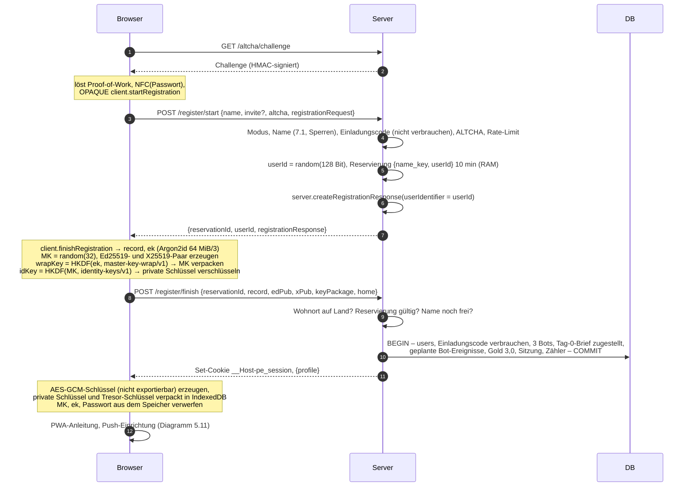

### 5.2 Login – bekannter und unbekannter Name (5.3, 5.10)

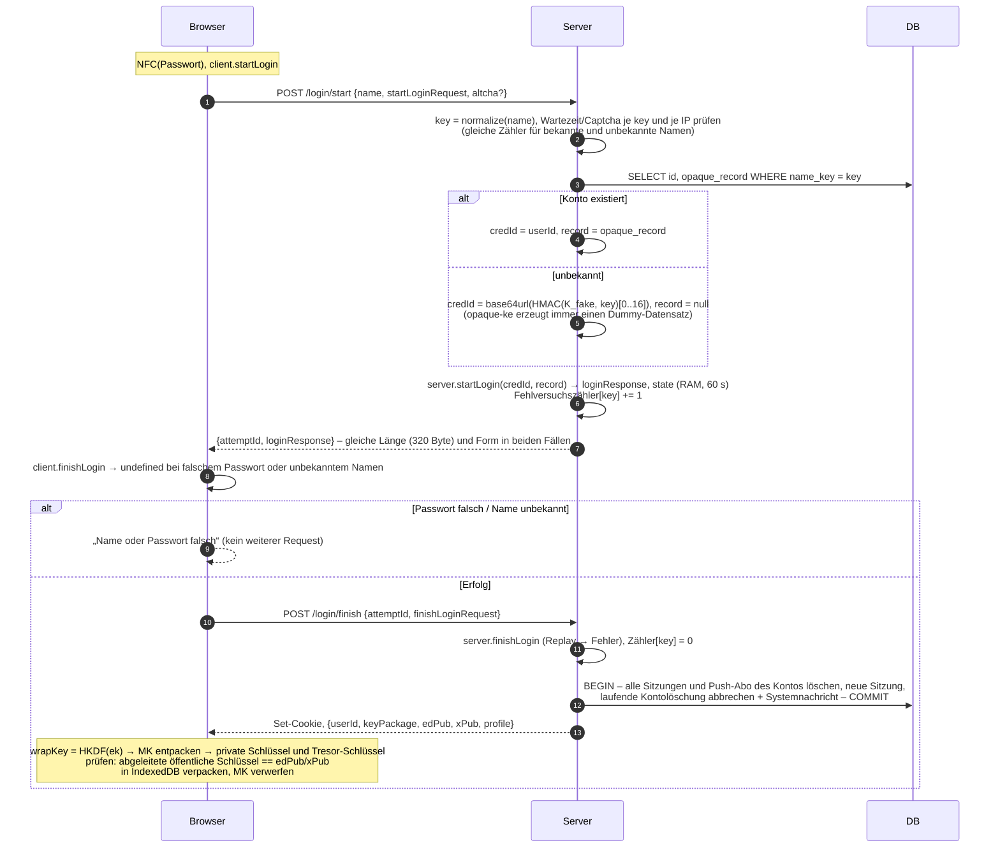

Ein Login-Versuch zählt beim Start als Fehlversuch und wird erst durch einen erfolgreichen Abschluss zurückgesetzt. Dadurch verhalten sich bekannte und unbekannte Namen gleich, obwohl der Server bei falschem Passwort keinen zweiten Request sieht. Gemessen auf dem Entwicklungsrechner: `server.startLogin` 1,9 ms (echt) zu 1,8 ms (Fake), also im Rauschen.

### 5.3 Wiederaufnahme der Sitzung (5.5)

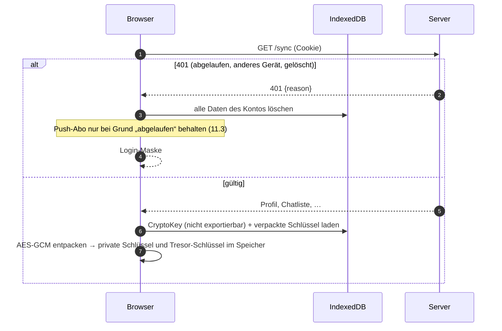

### 5.4 Passwortwechsel (5.6)

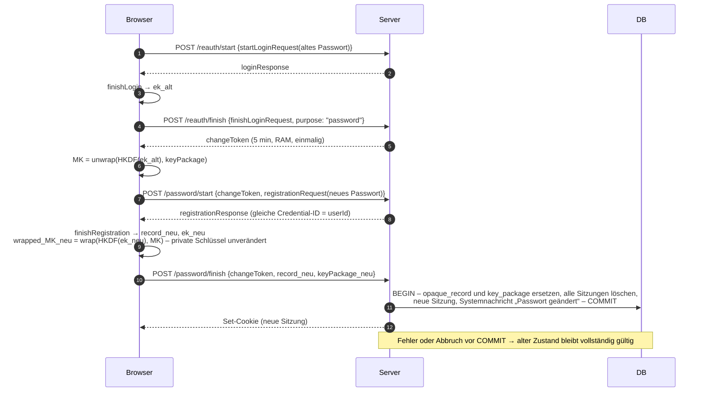

### 5.5 Konto löschen mit Re-Authentifizierung (7.5, 7.7)

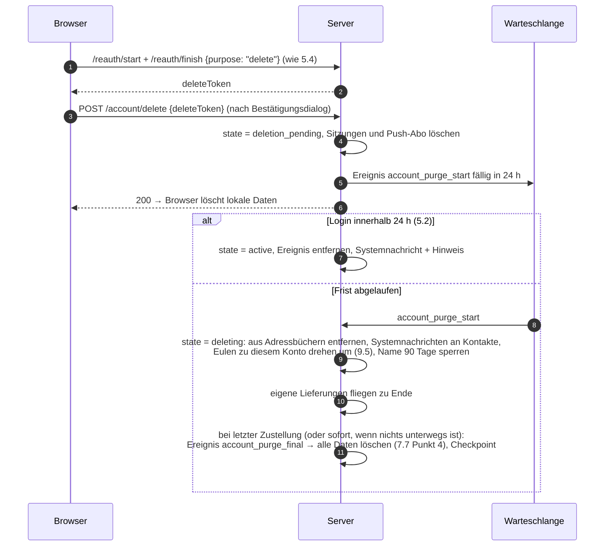

### 5.6 Admin-Login und erster Passwortwechsel (13)

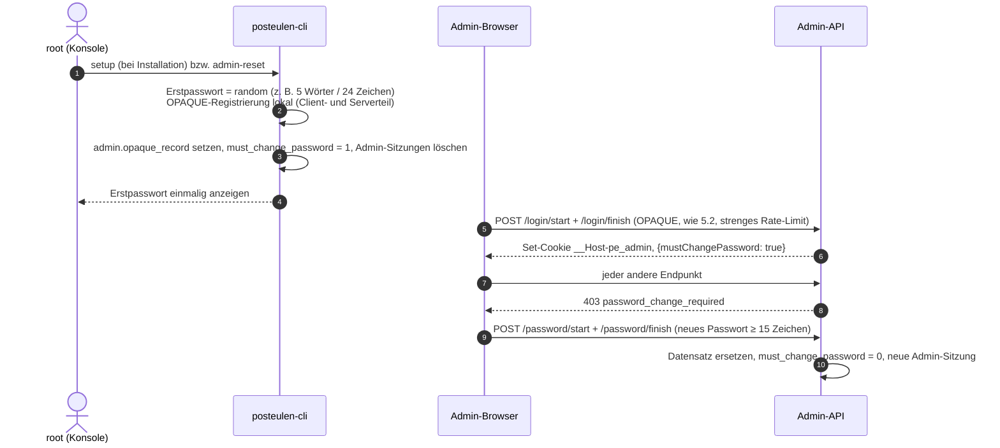

### 5.7 Koppeln und Kontakt-Tresor (8.8, 5.7)

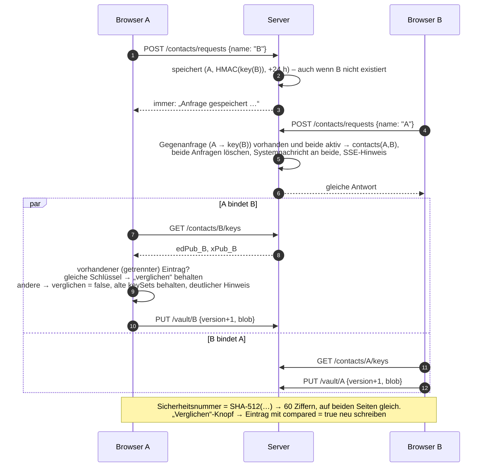

### 5.8 Schlüsselwarnung (5.7)

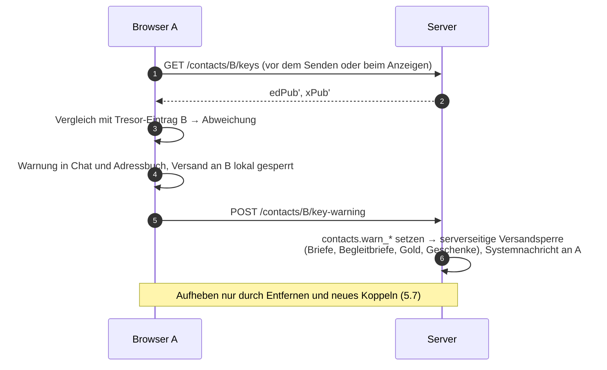

### 5.9 Brief senden und empfangen – auch Mehrfachversand (5.8, 8.4)

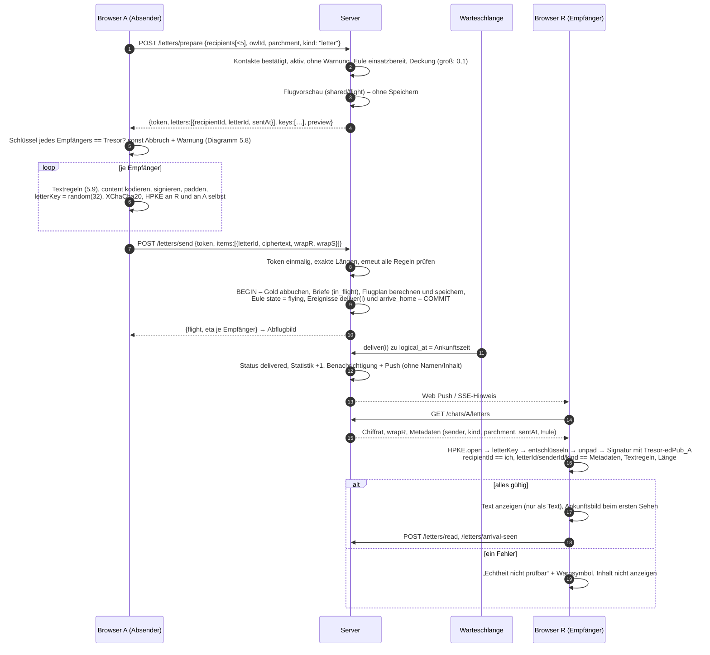

### 5.10 Begleitbrief zu Gold, Eule oder Küken (9.1.4, 9.2.7, 9.9)

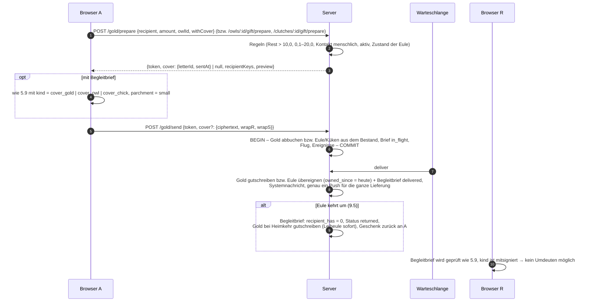

Beim Losentscheid (9.9) erzeugt der Server die Küken-Sendung ohne Begleitbrief. Dafür ist keine Mitwirkung des Browsers nötig.

### 5.11 Push-Verifikation (11.4)

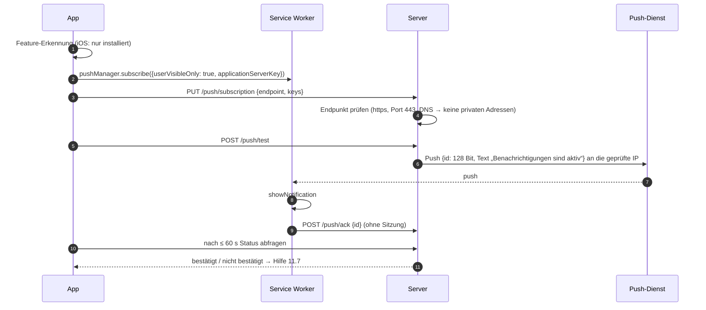

---

## 6. Ereignis-Warteschlange (4.5)

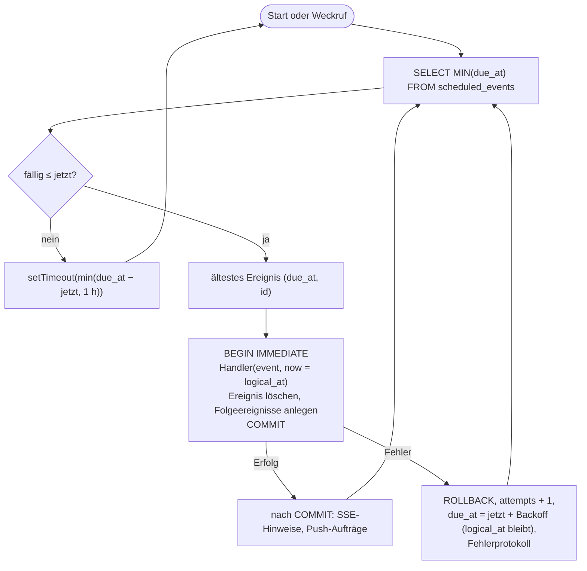

- **Genau-einmal-Wirkung:** Handler und das Löschen des Ereignisses liegen in derselben Transaktion. Zusätzlich prüft jeder Handler den Zustand (z. B. `deliver` nur, wenn der Brief noch `in_flight` ist). Doppelte Ereignisse bewirken daher nichts doppelt.
- **Logische Zeit:** `logical_at` ist der geplante Zeitpunkt. Handler bekommen eine Uhr, die `logical_at` liefert. So beginnt z. B. die Regeneration zur geplanten Ankunft, auch beim Nachholen nach einem Ausfall.
- **Weckruf:** Neue Ereignisse rufen nach dem Commit `queue.wake(dueAt)` auf. Liegt `dueAt` vor dem aktuellen Timer, wird neu geplant.
- **Tägliche Jobs:** Ein Ereignis `daily:<job>` plant sich nach der Ausführung selbst für den nächsten Tag ein. `daily_job_runs (job, day)` ist UNIQUE. Beim Nachholen gilt:
  - tägliches Gold: für **jeden** verpassten Tag ein Eintrag und eine Gutschrift, nur für die beim Nachholen aktiven Konten;
  - Menagerie-Angebot, Krankheitswurf, Inaktivitätsprüfung und Aufräumen: nur für heute; verpasste Tage werden als übersprungen eingetragen.
- **Push-Versand** läuft als eigener Ereignistyp, gedrosselt (z. B. höchstens 20 pro Sekunde bei Rundnachrichten).
- **Kontinuierliche Werte** (Energie, Position) werden beim Lesen aus Zeitstempeln berechnet (`shared/energy.ts`, `shared/flight/position.ts`). Dafür gibt es keine Ereignisse.

Ereignistypen: `deliver`, `arrive_home`, `treatment_end`, `brooding_end` (Schlupf), `chick_adult`, `clutch_gift_deadline`, `clutch_name_deadline`, `menagerie_end`, `loan_expire`, `bot_reply`, `bot_letter`, `bot_gold`, `contact_request_expire`, `account_purge_start`, `account_purge_final`, `push_send`, `daily:offer` (00:00), `daily:sickness` (03:00), `daily:inactivity` (04:00), `daily:gold` (15:00).

---

## 7. Spiellogik in `shared/` (reine Funktionen)

| Modul | Inhalt |
|---|---|
| `constants.ts` | alle Werte aus Anhang A, Arten aus Anhang B, Namen D/E – einzige Quelle |
| `names.ts` | `normalizeName`, `validateUserName`, `validateOwlName`, reservierte Namen (7.1) |
| `text-rules.ts` | `sanitizeLetterText` (NFC, Emojis nach `Extended_Pictographic` außer ©®™, Modifikatoren, Regional Indicators, U+FE0F, U+20E3, Steuer- und Richtungszeichen), `countChars` (5.9) |
| `gold.ts` | Zehntel-Arithmetik, Deckung, Überweisungsgrenzen |
| `energy.ts` | Regeneration, Füttern, Deckelung |
| `flight/plan.ts` | Simulation (Schritt ≤ 2 km / 5 min, Wechsel Tag/Nacht und Land/Wasser per Bisektion im Schritt), Schlafpausen, Wasser-Regel, Mehrfachroute, Küken-Rhythmus, Bot-Eulen (unbegrenzte Energie) |
| `flight/position.ts` | Interpolation auf dem Großkreis aus der Segmentliste (Server und Karte) |
| `flight/replan.ts` | Neuberechnung ab aktuellem Zustand bei Umzug und Umkehren |
| `geo.ts` | Haversine (R = 6 371 km), Zwischenpunkte, Rundung auf 0,01° |
| `landmask.ts` | Bitmaske 0,02° (Lesen; außerhalb des Ausschnitts = Wasser) |
| `sun.ts` | Sonnenhöhe (SunCalc), `isDay = altitude > −6°` |
| `chance.ts` | Krankheit (1/30, × 0,3 mit Pflegebonus), Eier (1/100), Küken (1–3), Start-Energie – alles mit injizierter Zufallsquelle |
| `owl-state.ts` | erlaubte Aktionen je Zustand (Tabelle 9.2.5) |
| `rng.ts` | Interface `Rng`; Server: CSPRNG (`crypto.randomInt`), Tests: deterministischer Seed |

Uhr und Zufall werden immer als Parameter übergeben (`{ now, rng }`). Das Backend ruft diese Funktionen in Transaktionen auf und ist allein maßgeblich. Der Browser nutzt `position.ts`, `sun.ts`, `landmask.ts`, `text-rules.ts` und `names.ts` nur zur Anzeige und für sofortige Rückmeldungen.

**Land/Wasser-Maske:** 34,7° × 24,8° bei 0,02° ergibt 1 735 × 1 240 Zellen ≈ 269 KB als Bitfeld, mit Brotli deutlich kleiner. Erzeugt wird sie einmalig von einem Werkzeug (`tools/map/`, eigene `package.json`, wird auf dem Server **nicht** installiert, D-09) aus Natural Earth 1:10m (Land, Seen). Ergebnis und Quell-Prüfsummen liegen im Repository.

---

## 8. Bedrohungen und Maßnahmen (3, 6)

| Bedrohung | Maßnahmen |
|---|---|
| **Datenbankdiebstahl** | Briefe nur als E2E-Chiffrat; Schlüsselpaket mit `ek` verpackt, das ohne OPRF-Schlüssel (Geheimnis-Datei) nicht berechenbar ist → kein Offline-Raten; Sitzungs-Tokens nur als SHA-256; Einladungscodes, Namenssperren und Kontaktanfragen nur als HMAC; OpenAI-Key mit Server-Schlüssel verschlüsselt; Backups mit age verschlüsselt, privater Schlüssel nicht auf dem Server |
| **Neugieriger Admin** | Adminpanel ohne Nutzerliste, Briefe oder Änderungsfunktionen (13); kein Login in Nutzerkonten möglich (OPAQUE, kein Passwort-Reset); Statistik nur aggregiert |
| **Passwort-Raten** | OPAQUE + Argon2id auf dem Client; steigende Wartezeiten je Name und IP/64 (RAM), ALTCHA ab 3 Fehlversuchen; gleiches Verhalten für unbekannte Namen |
| **Konto-Aufzählung** | deterministische Fake-Credential-ID, identische Antwortlänge, gleiche Zähler; Kontaktanfragen mit immer gleicher Antwort; „Name vergeben“ nur bei der Registrierung, durch Rate-Limit gebremst |
| **Sitzungsdiebstahl** | `__Host-`-Cookie (HttpOnly, Secure, SameSite=Strict; Nutzer-Cookie 30 Tage gleitend, Admin-Cookie nur Browsersitzung, D-92); Einzel-Sitzung; gleitender Ablauf; Logout löscht serverseitig |
| **XSS** | strikte CSP ohne Inline-Skripte/-Styles, Trusted Types (D-07); nie `{@html}` (Lint-Regel `svelte/no-at-html-tags` als Fehler); Links nur http(s), volle URL sichtbar; Textregeln auch beim Empfänger |
| **CSRF / Cross-Origin** | SameSite=Strict, Pflicht-Header, exakte Origin-Prüfung je API, kein CORS, getrennte Listener für Admin und Nutzer |
| **Injection** | nur parametrisierte Statements; strikte Schemas ohne unbekannte Felder; Größenlimits |
| **SSRF** | ausgehend nur zu OpenAI (feste URL) und zu Push-Endpunkten: https:443, DNS-Auflösung prüfen (keine privaten, Loopback-, Link-Local- oder reservierten Bereiche v4/v6), Verbindung an genau die geprüfte IP (eigener `lookup`), keine Weiterleitungen, Timeout, Antwortgröße begrenzt (D-06) |
| **API-Missbrauch, Spielmanipulation** | Server autoritativ; Browser sendet nur Absichten; Vorbereitungs-Tokens einmalig; jede Buchung atomar mit Deckungsprüfung; Rate-Limits je Klasse |
| **Gefälschte Absender, weitergereichte Briefe** | Ed25519-Signatur über Absender, Empfänger, Brief-ID, Art und Pergament; Tresor-Bindung; Prüfung gegen Server-Metadaten |
| **Schlüsseltausch durch den Server** (außerhalb des Modells, trotzdem erschwert) | Tresor mit AD-Bindung, Sicherheitsnummer, Versandsperre bei Abweichung |
| **Homoglyphen** | abschließender Zeichensatz, Verwechslungsregeln 0→o, 1→l, i→l, reservierte Namen, Namen immer in Atkinson Hyperlegible |
| **Datenabfluss an Dritte** | keine fremden Ressourcen (Playwright prüft das); Push-Texte ohne Namen und Inhalte; OpenAI ohne Kennungen und mit `store: false`; keine IPs in Logs (Caddy-Filter, Pino-Redaktion) |
| **Lieferkette** | Lockfile mit exakten Versionen; neue Versionen erst ab 14 Tagen Alter (D-10); `npm ci --ignore-scripts`; `npm audit` im Testbefehl; signierte APT-Quellen |
| **Server-Härtung** | systemd-Härtung (6), Node nur auf localhost, Firewall, automatische Sicherheitsupdates, SSH-Härtung nur nach Rückfrage |

---

## 9. Frontend

- **Nutzer-PWA:** Svelte 5 + Vite, ohne SvelteKit. Eigener kleiner Router (History-API). Zustand in Svelte-Runes-Stores. Krypto läuft im Haupt-Thread (Argon2id ≈ 0,3 s auf dem Desktop; die Messung auf dem Handy folgt in Stufe 1), bei Bedarf im Web Worker.
- **Service Worker:** selbst geschrieben, ohne Workbox (D-08). Er cacht die App-Hülle mit versioniertem Namen, verarbeitet Push und Bestätigungen und meldet neue Versionen.
- **CSP-Verträglichkeit (D-07):** Svelte 5 setzt Styles über das CSSOM und Übergänge über die Web Animations API; beides ist mit `style-src 'self'` vereinbar. Statische `style="…"`-Attribute in Templates sind verboten (Lint-Regel). Svelte bringt eine Trusted-Types-Policy `svelte-trusted-html` mit. Die CSP enthält deshalb `require-trusted-types-for 'script'; trusted-types svelte-trusted-html posteulen-sw` (die zweite Policy erlaubt genau `/sw.js` für die Registrierung des Service Workers, D-30). Diese Policy lässt das HTML ungeprüft durch und ist nur sicher, weil `{@html}` verboten ist. Ein Playwright-Test lauscht auf `securitypolicyviolation` und schlägt bei jedem Verstoß fehl.
- **ALTCHA-Widget:** wird selbst gehostet. Ob es ohne Inline-Styles auskommt, prüfe ich in Stufe 1. Sonst baue ich eine eigene kleine Svelte-Komponente auf `altcha/lib`.
- **Bilder:** Der Build (`sharp`) erzeugt WebP in 160, 480 und 960 px mit Hash im Namen und ein Manifest. Fehlende Bilder ersetzt er durch einen Platzhalter und gibt eine Warnung aus (9.2.6).
- **Hilfe, Datenschutz, Impressum:** strukturierte Texte in `shared/texts/help.ts` und `legal.ts` (v0.4: englisch in `help-en.ts`, `legal-en.ts`; Auswahl über `helpOf`/`legalOf`), dargestellt von `TextPage.svelte` (Inhaltsverzeichnis, Sprungmarken, nur Text). `helpAsText(language)` liefert dieselbe Hilfe als Wissensbasis des Erklärbärs (D-91).
- **Sprache (v0.4, D-142 bis D-145):** `web/src/lib/i18n.svelte.ts` hält die Sprache der Ansicht (`localStorage` vor dem Login, danach `profile.language`) und liefert über den Proxy `t` die Texte; `App.svelte` rendert beim Wechsel neu (`{#key}`). Das Fähnchen (`LanguageFlag.svelte`) und die Einstellung speichern angemeldet per `PATCH /api/account/language`. Der Server nutzt `languageOf()` für Bot-Briefe, Bot-Namen, KI-Prompts, Push-Nutzlast (`lang`) und Leiheulen-/Kükennamen.
- **Schriften:** Atkinson Hyperlegible Next (Fließtext, Namen) und eine Zierschrift für Überschriften (Cinzel Decorative, F-08), beide OFL, als WOFF2 selbst gehostet.

---

## 10. Installation und Update auf Debian 13 (16)

### 10.1 Verzeichnisse

| Pfad | Inhalt | Besitzer | Von Updates |
|---|---|---|---|
| `/opt/posteulen/repo/` | Git-Klon der Quelle (Remote konfigurierbar, Deploy-Key möglich) | root | aktualisiert (`git fetch --tags`) |
| `/opt/posteulen/releases/<version>/` | ausgecheckter und gebauter Stand je Version | root, lesbar für den Dienst | neu angelegt; die letzten 3 bleiben |
| `/opt/posteulen/current` | Symlink auf das aktive Release | root | umgeschaltet |
| `/var/lib/posteulen/` | `posteulen.sqlite` (+ WAL), 0700 | posteulen | nur Migrationen |
| `/var/backups/posteulen/` | `*.sqlite.age` (täglich und vor Updates), 7 Tage | root | nie überschrieben |
| `/etc/posteulen/secrets.json` | Geheimnisse, 0640 root:posteulen | root | nie (Ausnahme 4.4) |
| `/etc/posteulen/backup.pub` | öffentlicher age-Schlüssel | root | nie |
| `/etc/posteulen/posteulen.conf` | Domain, Repository, Optionen | root | nur ergänzt, nie überschrieben |
| `/etc/posteulen/local/` | lokale Anpassungen (z. B. `admin-allowlist.caddy`) | root | nie |
| `/etc/caddy/Caddyfile` | erzeugt aus Vorlage, importiert `/etc/posteulen/local/*.caddy` | root | neu erzeugt (lokales bleibt in `local/`) |
| `/etc/systemd/system/posteulen.service`, `posteulen-backup.{service,timer}` | Units | root | neu erzeugt |
| `/usr/local/sbin/posteulen-update`, `posteulen-cli` | dünne Wrapper auf `current/deploy/…` | root | neu erzeugt |

### 10.2 Installation (`deploy/install.sh`, 16.2)

1. Prüfungen: Debian 13, root, Architektur (amd64/arm64), RAM/Speicher, Ports 80/443 frei, DNS von `<domain>` und `admin.<domain>` (nur Warnung).
2. Fragen oder Parameter: `--domain`, `--admin-allowlist`, `--repo`, `--yes`, `--test-mode` (`tls internal`, keine DNS-Prüfung).
3. APT: NodeSource `node_26.x` (signed-by `/usr/share/keyrings/nodesource.gpg`), Caddy (Cloudsmith, signed-by), `age`, `git`, `nftables` bzw. `ufw`, `unattended-upgrades` mit zusätzlichen Origins (`. nodistro`, `cloudsmith/caddy/stable`) und Neustart betroffener Dienste. SSH-Härtung nur nach Rückfrage und nur, wenn für den Anmelde-Benutzer ein Schlüssel hinterlegt ist. Swap-Datei nach Rückfrage, wenn RAM < 1,5 GB.
4. Benutzer `posteulen`, Verzeichnisse, Release bauen (`npm ci --ignore-scripts`, `npm run build`), `posteulen-cli setup` (legt Geheimnis-Datei und Admin-Datensatz nur an, wenn sie fehlen), age-Schlüsselpaar (nur wenn `backup.pub` fehlt und kein `--backup-pubkey` übergeben wurde; F-05), Migrationen, Caddyfile, Units, Backup-Timer.
5. Start, Funktionsprüfung über HTTPS: Website, Adminpanel, `/api/health`, Sicherheits-Header.
6. Zusammenfassung, Admin-Erstpasswort einmalig, unübersehbarer Sicherungshinweis (Geheimnis-Datei, privater Backup-Schlüssel).

Idempotent: Jeder Schritt prüft vorher den Ist-Zustand. Vorhandene Geheimnis-Datei, Datenbank, Backups und `local/` werden nie angefasst.

### 10.3 Update (`posteulen-update`, 16.3)

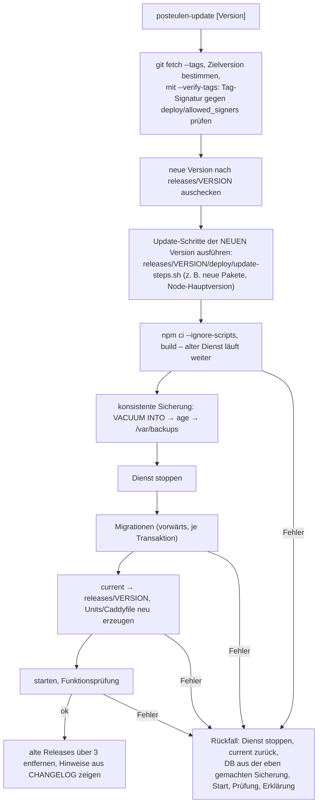

- `--check` zeigt die installierte und die verfügbare Version samt Changelog-Auszug. `--rollback` geht zum vorigen Release und zu dessen Sicherung zurück, mit Warnung vor Datenverlust.
- **Schema-Schutz:** Jede Migration erhöht `user_version`. Der Server weigert sich zu starten, wenn `user_version` größer ist als seine höchste bekannte Migration.
- **Geheimnis-Datei und DB gehören zusammen:** `posteulen-cli check` vergleicht eine in der DB abgelegte Prüfsumme (aus `rootSecret` abgeleitet) mit der Datei. So fällt eine falsche Geheimnis-Datei bei Restore oder Update sofort auf.
- **Browser:** Der Service Worker erkennt die neue Version. Die API antwortet veralteten Clients mit `client_outdated`.

### 10.4 Backups

Täglicher systemd-Timer: `VACUUM INTO` in ein privates temporäres Verzeichnis (`PrivateTmp`), dann `age -R /etc/posteulen/backup.pub`, danach wird der Klartext sofort gelöscht. Das Timer-Skript löscht Sicherungen, die älter als 7 Tage sind. Das README beschreibt das Abholen per SSH von einem anderen Rechner (dort ebenfalls 7 Tage) und die Wiederherstellung Schritt für Schritt (KANN: `posteulen-restore`).

### 10.5 Tests von Installation und Update (17.6)

Auf dem Entwicklungsrechner (Debian 13, KVM ohne Root nutzbar) startet `deploy/test/run-vm.sh` ein offizielles Debian-13-Cloud-Image (Prüfsumme gegen die signierte `SHA512SUMS`) mit QEMU/KVM, cloud-init und Port-Weiterleitung. In der VM laufen:
1. `install.sh --test-mode --yes`, Funktionsprüfung;
2. ein zweiter Lauf, der nichts überschreibt (Prüfsummen von Geheimnis-Datei und DB vorher/nachher);
3. ab Stufe 1: Installation des vorigen Tags, Testdaten anlegen (Konten, Briefe per Playwright-Skript), Update auf den neuen Stand, Login und alte Briefe prüfen;
4. ein absichtlich kaputtes Update (Test-Tag mit fehlerhafter Migration) → automatischer Rückfall, danach `--rollback`;
5. Wiederherstellung nach README: auf demselben Server und nach einem Totalausfall (alle Serverdaten gelöscht, Neuinstallation mit geretteter Geheimnis-Datei und bisherigem Backup-Schlüssel); `shellcheck` über `deploy/`.

---

## 11. Teststrategie (17)

- **Ein Befehl:** `npm test` = Lint, Typprüfung (`tsc`, `svelte-check`), Vitest mit Abdeckung (Grenze 90 % Zeilen für `shared/crypto`, `shared/` (Spiellogik), `web/src/crypto`), `npm audit`, `shellcheck`. `npm run test:e2e` = Playwright (Handy, Desktop, Graustufen, Netzwerk- und CSP-Prüfung, Barrierefreiheit mit axe-core nach WCAG 2.2 AA an jeder Seite und jedem Screenshot-Zustand, D-93). `npm run test:vm` = 10.5.
- **Krypto:** Ende-zu-Ende über echte Bibliotheken; Manipulationstests flippen gezielt Bytes in Chiffrat, AD und Metadaten; ein Abfangtest prüft alle Requests auf Passwort, Klartext und private Schlüssel (17.1, letzter Punkt).
- **Spiellogik:** feste Uhr, deterministischer Seed; fast-check für Schemas, Normalisierung, Textregeln und Gold-Arithmetik.
- **Routen-Inventar:** `backend/test/routes.test.ts` liest alle Endpunkte aus dem Quelltext und prüft Sitzungspflicht und leere Inhalte (D-94).
- **Berechtigungen:** eine Tabelle aller Endpunkte, die automatisch gegen fremde Objekte, Nicht-Kontakte, inaktive und gelöschte Konten sowie Admin/Nutzer-Trennung geprüft wird (17.3).
