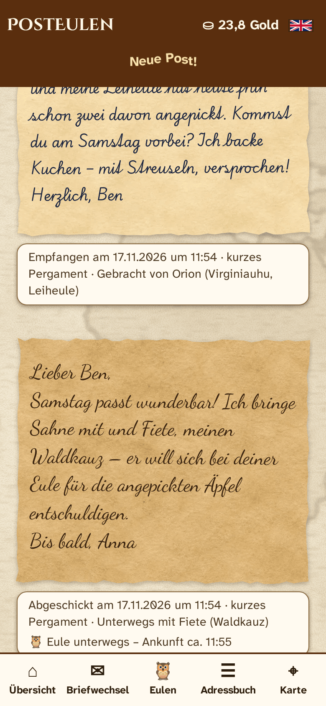
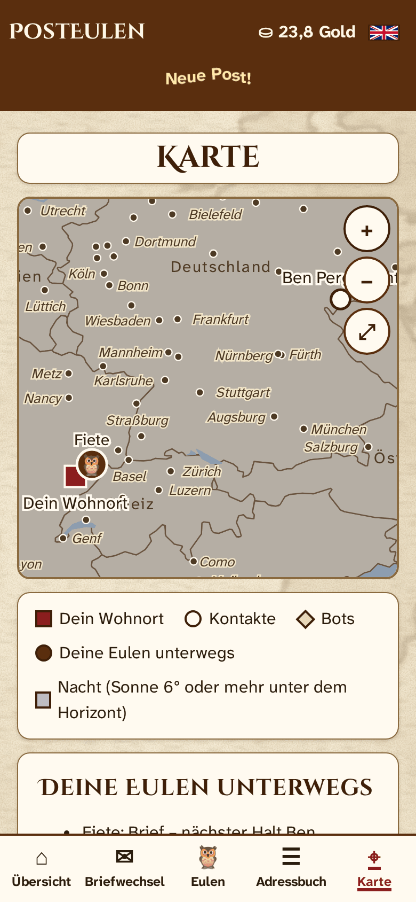
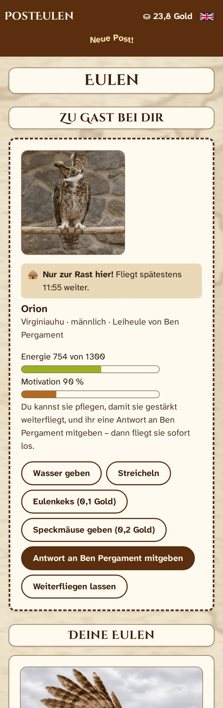

# PostEulen.de 🦉

**Letters brought by an owl.** A running instance lives at **[posteulen.de](https://posteulen.de)** – do drop by.

🇩🇪 *Diese README auf Deutsch: [README.md](README.md)*

> The name *PostEulen* is German for “post owls”. The app speaks German and English: tap the little British flag in the top right corner and everything – menus, help, system messages and even the bots’ letters – switches to English.

---

## Part 1: For everyone who likes getting post

<p align="center">
  
</p>

Remember how lovely it was to find a real letter in the letterbox? PostEulen brings that feeling back. Your messages do not dash through the net in milliseconds; they are brought by an owl – and the owl, being an owl, has a mind of its own: depending on distance, time of day and fitness, it is on its way for a few hours. It prefers flying at night (less tiring), it bravely keeps going over the sea, and when it really cannot go on, it takes a nap – just long enough to have the strength for its next destination. You can watch it on the map – which now shows the whole world, even though all owl keepers live in Western Europe.

You buy owls in the Menagerie or borrow them at the owl post office, name them, give them water, pet them and spoil them with owl biscuits or their favourite snack – hungry owls even several times a day until they are full. Twenty owl species live in the Menagerie, from the tiny Elf Owl via the rust-red Eastern Screech Owl and the Cyprus Scops Owl to the mighty Great Horned Owl – and a phoenix that one morning was simply sitting on the window sill. Each of them tells you a little about its character there. Not every owl carries everything: small owls only manage a short parchment, medium ones a long one as well, and only the strong ones also carry gold. Cared-for owls are motivated and then fly their next leg faster and further – neglected ones look grumpy; well looked-after owls also fall ill less often, and with a bit of luck one of them lays eggs one day – all the more if a male of her species lives at home with her or she rests next to one at a pen friend’s. If she broods while it is dark where you live, she keeps watch in the nest at night. While an owl is on its way, the overview shows it flying – in sunshine or under the stars – and the map shows it as a little dot over land and sea. While it rests with a recipient, the overview shows its empty perch. When it takes a nap on the way, you see it asleep, and when it comes home, it sits on the window sill waiting for you – in daylight or by candlelight, the next time you open the app. By day it likes to doze there too – and when it is dark where you live, you see it wide awake at night; owls are night birds, after all. The pictures of your owls take centre stage, and on the way each one tells you its next stop with the time.

**Christmas in the owl tower:** from the first Sunday of Advent to Boxing Day the post office, the Menagerie and the owls wear Christmas decorations, and letters from that time lie on Christmas parchment for good – one of four papers, drawn once for each correspondence and the same on both sides.

You get gold every day (3 gold pieces during your first 30 days, 2 after that), and pen friends join in, too: a patient **Explainer Bear** who explains everything, and more characters brought to life by the operator of your instance. They live somewhere in the world, write to everyone at special moments, sometimes add pictures or a small gift – a few owl biscuits or treats for your pouch, say – and take up your reply personally in their next letter. Their owls sometimes fly across the sea for this and then wait with you for a while, so you can look after them (free of charge) and hand them a reply.

### Game? Messenger? Both – and seriously secure.

PostEulen deliberately sits on the border between game and messenger. The owls are the game. **The encryption is not.** Beneath the parchment surface, hard, serious, up-to-date cryptography is at work:

- Letters between people are encrypted **on your device** (XChaCha20-Poly1305) and signed (Ed25519). Only sender and recipient get the key, wrapped according to the HPKE standard (RFC 9180).
- Your **password never leaves your device.** Signing in uses OPAQUE (RFC 9807) – the server can neither see your password nor guess it from a stolen database. When you choose it, the app already makes sure it does not contain your user name and is not a well-known everyday password.
- A **safety number** shows you that nobody is sitting in between. Your device also compares your contacts’ keys before every letter and when you open a conversation, and raises the alarm if something is wrong.
- **Disguised links stand out:** if an address only looks like a familiar one – say, with a Cyrillic “а” instead of an “a” – PostEulen shows it in its technical form, with a warning.
- **Only one valid session:** your account is only ever signed in on one device. If someone signs in with your password, you are thrown out – if you keep getting signed out although you do not sign in anywhere else, someone is probably using your password. Change it at once.
- **No read receipts:** the other person only sees that their letter was delivered – whether and when you read it stays your secret.
- No adverts, no tracking, no stored IP addresses, no content from other servers.

**Sparing with data from the start:** you need neither your real name nor an email address or phone number. You can play under a pseudonym and choose a fictional home. Using it via a VPN, the Tor network or Tor Browser works too – in Tor Browser at the security level “Standard” (the stricter levels switch off WebAssembly, which the login needs) and without notifications.

**The owls also live in the Tor network:** PostEulen can additionally be reached as an onion service – a hidden owl tower with an entrance of its own. You will find the link “Tor network” on the start page in the bar of links below the sign-in box; if you open PostEulen in the Tor Browser, it even suggests the onion address by itself (“.onion available”). Everything there is as usual: the same account, the same letters, the same owls. You can switch as you like – but you are only ever signed in in one place at a time. Over Tor the server does not even learn your IP address; in return, all Tor users share the limits that protect against overload, as if they were one single visitor. If it gets busy there, a short wait helps. The admin panel and the bots control centre have onion addresses of their own too; all addresses are listed on the start page under “About this instance”. And the **admin panel** used to run the game server offers no views of player names, contact relationships or letter contents. The only thing it shows in plain text is the feedback on the software that users choose to send in the settings.

So PostEulen is quite suitable as a secure way of communicating – as long as minutes do not matter. What it cannot hide: *who* writes to *whom* and *when*. And anyone holding your unlocked phone can of course read along. That is not the owl’s fault.

### Good to know

- **Letters do not last for ever.** For new accounts, letters are deleted automatically and for good **180 days** after delivery. In the settings you choose 30, 90, 180 days or one year; nothing stays longer than a year. Tidying up happens once a week, early on Mondays – so a letter may stay up to seven days longer. Anything you want to keep is best copied out – like in the old days.
- **Forgotten password means: account gone.** Nobody can reset it, not even the operator. That is not a bug; it is the price of real encryption.
- **A map like an old atlas:** the map looks like a hand-drawn historical atlas – parchment, fine coastlines, hatched mountains, little forests, rivers and lakes. Trees and mountains stand only on land, never in the water. The closer you zoom in, the more landscapes, rivers and seas carry their names; around Western Europe right down to the Harz, the Black Forest and the Swabian Jura.
- **Letters have room:** a small letter holds 800 characters, a large parchment 15,000 characters – both free. Not every owl carries the large one, though: small and dainty species such as the Elf Owl, the Barn Owl or the Long-eared Owl only take short letters.
- **One owl, many friends:** your own owls and loan owls fly to up to five recipients one after another – on the shortest route. Every ready owl has a “Write a letter” button in the owl overview; when writing, the owl choice is there at once – it only offers the loan owls of the day if none of your owls can carry the letter. In the correspondence every letter shows below it when it arrived or when you sent it, on which parchment and with which owl; your writing field already looks like your letter. When an owl lands with post, you see it as soon as you open the app.
- **A team of your own:** at the owl post office you first stand outside – “Enter the owl post office” takes you in, where you see the team of the day at work (by day, at night, decorated in Advent). One of four owl teams is on duty every day – drawn for each account separately, never the same one twice in a row – and you can borrow all of its owls – with values, what they carry and the loan fee (0.1 gold, owls that also carry gold 0.2 gold). There you can also look after your borrowed owls and send them off. At the counter you are greeted and told who is ready to travel, and every loan owl introduces itself with a few words. Once a loan is over, its offer disappears until tomorrow.
- **Who is ready?** Under “My owls”, all owls that can set off right away are at the top – your own and borrowed ones together, the one you have had longest first; loan owls carry “(loan owl)” after their name. Below are the ones that are travelling or busy, the next to come home first. Below the name of each of your own owls you can see how many kilometres it has flown so far.
- **Step inside:** the Menagerie now has a door too. Inside, the owls sit in wall niches and along the spiral staircase while the keeper sweeps. Above your letters stands a desk by the window – outside the seasons go by, and at night the candles are lit.
- **Gold with the owl:** if an owl can carry gold and you have enough, it has the button “Send gold” in the owl overview. Bookings and the daily gold are in the settings.
- **The owl rescue centre:** behind a wooden gate by the stream – with pictures that change with the seasons – sick and injured owls are nursed back to health. If one of your owls falls ill, it moves in there; under “My owls” you then see its empty perch. Water, stroking, medicine, food and snacks (each once a day, stroking as often as you like) fill its recovery bar until it may go home – if it gets well at night, you see it under the stars. There is also always one wild sick owl waiting – some fly gratefully back into freedom afterwards, some stay with you as a post owl.
- **Once around the world – and to the Moon:** an owl that has flown further than the Earth’s circumference (more than 40,030 km) wears a little globe 🌍 after its name from then on. From 384,400 km – the distance to the Moon – it becomes a moon 🌙, from a million kilometres a crown 👑. Every badge is announced with a festive system message.
- **Names that fit – and stay:** loan owls, chicks with random names and the wild owls of the rescue centre get a name that suits them; in the post office you see before borrowing whether it is a she or a he. A name stays as it was rolled – even if you switch the language or the owl flies to someone who uses PostEulen in German.
- **Your statistics:** the settings show how many letters you have sent and received, how long your account has existed, on how many days you were around, how many kilometres your owls have flown between people and how much attention your owls have had.
- **ASCII art:** if you like drawing pictures with letters, switch on ASCII mode in the settings and send single letters in a typewriter font – for both sides.
- **Gifts among the active:** gold and owls can only be given away by active players, once every two weeks.
- **A pouch full of biscuits:** if a bot puts owl biscuits or treats into a letter for you (or you redeem a voucher for them), they go into your pouch. While there is something in it, feeding and treats cost nothing – every owl likes the treats. The post office, “My owls” and the rescue centre show at the top what is still in it.
- **Tidy buttons:** the buttons under an owl form a neat block across the whole width – and only those that work right now are there. Whatever has already been done today or is not allowed at the moment disappears until it is possible again.
- **Long correspondences in the cellar:** from 30 letters on, a correspondence first shows the latest 25 (and all unread ones); at the very top, “Search the cellar for older letters” brings up the rest. This also applies to the system messages and the bots.
- **Help at hand:** the question mark at the top right next to the flag leads to the help, the on/off button next to it signs you out after asking; it is also at the very bottom of the settings and in your letters with the Explainer Bear. Large numbers have thousands separators.
- **Something not working?** At the very bottom of the settings you send the admin of your instance a short message – for problems and ideas.
- **Owls take a rest:** when writing, you choose how long the owl stays with each recipient (not at all, 1, 2, 6, 12, 24 or 48 hours; preselected 2 hours with your own owls, 24 with loan owls). There it may be pampered and takes a reply back to you – with a reply on board it flies on at once. In the recipient’s conversations a little owl symbol stands behind your name; they can also send it on earlier without a letter.
- **Notifications that think along:** if an owl brings you post and rests with you, it announces itself only once. You are also notified when a new contact is connected with you or one of your owls falls ill. Tapping a notification opens the right page, and if one does not get through once, PostEulen tries again later. “New post!” in the bar at the top is only for letters; system messages just show their counter.
- **Chicks need time:** you have five days for names and the gift before the lot decides. Owls can be released into the wild once you have more than 5 of your own.
- **An aviary with room for every species:** everyone can have at most as many owls of their own as there are species (currently 21). Once the aviary is full, no new owls come in – healed wild owls then fly off into freedom, and chicks that hatch are given to friends who still have room.
- **Owls want to carry letters:** if an owl takes no letter to a person for three weeks, it grows bored and gazes longingly out of the window. If you do not send it off soon after, it flies away – but your last owl always stays.
- **Helping out at the post office:** your own owls help out at the owl post office for a week (once a quarter) and bring back a little gold. Loan owls arrive well rested, with at least three quarters of their energy.
- **Holiday mode – a break without drawbacks:** holidays, a trip away or exams? In the settings you send your owls up to three times a year for up to six weeks to the owl care station on the little island of Inchlonaig in Loch Lomond. There they are well looked after, do not fall ill and do not get bored; all of them are home again exactly when it ends. You need not sign in during that time – your account does not count as inactive. On the map you see them fly there and back.
- **Links as you like:** a switch in the settings decides whether links in letters can be clicked.
- **German or English:** a little flag in the top right corner switches the whole app to English (and back). Accounts remember their language; the pen friends then write in English too.
- **PostEulen is free** – no adverts, no paywall. Every five weeks a small system message asks, with a wink, for a voluntary donation via [ko-fi.com/posteulen](https://ko-fi.com/posteulen); the “Donate” link is also at the bottom of the start page. Nobody has to, everybody may. Why it still helps is explained below under “Who pays for all this?”.

### A good first messenger for children

PostEulen is also a great way to introduce children gently to messengers:

- **No pull, no constant availability.** Letters take hours to arrive. Nobody waits for an instant reply, and there is nothing that tempts you to keep checking – the owl arrives when it arrives.
- **No phone of their own needed.** PostEulen runs in an ordinary web browser – also on a parent’s phone, tablet or computer. The child signs in there with their own account and signs out again afterwards; they do not need a smartphone of their own.
- **No strangers.** Only people who have entered each other with the exact name in the address book can write. There is no search for other users, and requests from strangers are invisible. This way parents keep track of who can write to their child.
- **Breaks without drawbacks.** When holidays or exams come up, you switch on holiday mode: the owls relax for up to six weeks at an owl care station on a Scottish island, and nobody has to sign in meanwhile. And in general, PostEulen is built with few buttons and no pull – the letter is at the centre, not the game.
- **Easy on the eyes.** PostEulen is designed to work perfectly in the device’s greyscale mode, so the colourful overload can simply be switched off – pleasant for children in particular.
- **No real money.** PostEulen has no in-app purchases and no other way of spending real money. Every player automatically receives the in-game currency, gold, as a gift every day – owls, food and parchment are paid for with it alone. It is never about real money; the voluntary donation to the operators happens outside the app and gives nothing in the game.
- The pen friends – the Explainer Bear and other bots – reply using AI (their letters are not encrypted and are sent to OpenAI to be answered). If you do not want that, remove them in their correspondence – or all at once, for good and for future bots too, in the settings (“Remove all bots”). They never appear in the address book; only real people are listed there.

### How does PostEulen get onto your phone? Without an app store!

You get apps from the app store, right? Usually, yes. PostEulen is deliberately not there – and still it becomes a real app with its own owl icon. The trick: some websites can turn into an app (experts say “Progressive Web App”, but you may forget the term straight away). You simply put it on your home screen. Nothing is installed secretly, the app wants neither your photos nor your contacts, and updates arrive by themselves.

- **Android with Chrome:** open [posteulen.de](https://posteulen.de) → tap the three dots ⋮ in the top right corner → “Add to Home screen” → “Install” (sometimes it is simply called “Install app”).
- **iPhone or iPad with Safari:** open [posteulen.de](https://posteulen.de) → share icon (square with an arrow; on newer iPhones behind the three dots ••• at the bottom right) → “Add to Home Screen” → “Add”. After that, always open PostEulen with the new icon.
- **All other phones, Firefox and computers:** simply add a bookmark to your home screen or use it in the browser as usual. Everything works the same.

The only difference: notifications (“An owl has landed!”) are only available in the app on the home screen of Android/Chrome and iPhone/Safari. In the browser your post arrives anyway – you see it the next time you look in. In real life the letterbox does not ring either. 😉

**Special case: Android without Google services** (LineageOS, GrapheneOS, /e/OS …): Chrome and its relatives deliver notifications only via Google services. Without them it works with **IronFox** or **Fennec** (from F-Droid) plus a **UnifiedPush** app such as **Sunup** or **ntfy**: in IronFox go to Settings → IronFox settings → Miscellaneous, turn on “Use UnifiedPush”, restart the browser and allow notifications for PostEulen (Privacy and security → Site settings → Permissions → Notifications → “Ask to allow”). On GrapheneOS, “Sandboxed Google Play” with Chrome is an alternative. The detailed help in the app explains this step by step.

The help in the app explains everything else, and the Explainer Bear answers questions by letter.

<p align="center">
  
  &nbsp;
  
  &nbsp;
  
</p>

### Who pays for all this?

PostEulen is a hobby project that, sadly, costs real money. At the moment development and running it cost about **€25 a month**. Every additional active account adds a little to that. If it matters to you, too, that we can keep offering PostEulen in the future, you can support us [here](https://ko-fi.com/posteulen) with a donation. **Every donation helps to keep PostEulen online and freely accessible to everyone.** Thank you!

---

## Part 2: For everyone who would like to run their own owlery

You want to open your own owlery? Go ahead. This guide explains step by step how to run PostEulen on your own server (VPS) with **Debian 13** over HTTPS. It is written for beginners; every step of the scripts is explained so you could also do it by hand if necessary. Owls are not included – the software creates them.

> **For the paranoid (in the best sense):** you do not have to trust this repository. You can rebuild PostEulen yourself at any time – with or without AI. All you need is [`PROMPT.md`](PROMPT.md) (the build brief), [`SPEC.md`](SPEC.md) (the specification) and the picture folder [`images/`](images/). Between ourselves: `SPEC.md` is really where the essence of all the thinking and the many tests that went into this project lives – the code is basically just its most diligent translation. An instance built from the SPEC stays compatible with the data of this one (SPEC appendix L).

The scripts and the admin panel speak German; the commands below are the same in any language.

Version: **1.4.0** – holiday mode (up to three times a year a break of up to six weeks without drawbacks, the owls relax on the island of Inchlonaig); bored owls that threaten to fly off after three weeks without a letter to a person; at most as many own owls as species; releasing from six owls on; lending to the post office once a quarter; better-rested loan owls; under the owls only buttons that work right now; the door of post office and Menagerie right below the picture; one owl symbol per resting owl; onion addresses of their own for the admin panel and the bots control centre and all six addresses under “About this instance”. The update brings a database migration that runs automatically during the update (details in [CHANGELOG.md](CHANGELOG.md) and SPEC Anhang F).

**In short**

1. Prepare server and domain ([section 1](#1-requirements)).
2. One command installs everything ([section 2](#2-installation-with-one-command)).
3. Back up the secrets file and the backup key outside the server ([sections 2](#2-installation-with-one-command) and [5](#5-backups-and-restoring)).
4. In the admin panel: change the password, open registration, enter the OpenAI key ([section 3](#3-first-login-to-the-admin-panel)).
5. Adapt the privacy policy and imprint to your own instance ([section 9](#9-privacy-policy-and-imprint)).

### 1. Requirements

- A VPS with a freshly installed Debian 13 (amd64 or arm64). At least 1 GB of RAM (2 GB recommended), 1 CPU core, 10 GB of storage. With less than 2 GB of RAM the script offers to create a swap file so that the build does not fail.
- Your own domain, e.g. `posteulen.de`.
- Three DNS records (A for IPv4 and – if the server has an IPv6 address – AAAA for IPv6) pointing to the server’s address, plus `www` if you like:

  ```
  posteulen.de        →  IP of the server
  admin.posteulen.de  →  IP of the server
  bots.posteulen.de   →  IP of the server   (bots control centre)
  www.posteulen.de    →  IP of the server   (optional: redirects to posteulen.de)
  ```

  Without these records Caddy cannot get HTTPS certificates from Let’s Encrypt. If the server has IPv4 **and** IPv6, every name needs an A **and** an AAAA record – otherwise the script says so clearly. The Tor network needs neither a DNS record nor an open port: the script sets up the onion address by itself.
- SSH access to the server, ideally with an SSH key instead of a password. You store the key from your own computer with `ssh-copy-id user@server`. Only then does the installation script offer to switch off password login.
- For the bots, an OpenAI API key (<https://platform.openai.com>). Without a key everything else works; the bots just do not reply – the Explainer Bear only sends his fixed letters, the other bots their planned letters unchanged.

### 2. Installation with one command

On the server, as a normal user with sudo rights (or as root):

```bash
sudo apt update && sudo apt install -y git
git clone https://github.com/diplomendstadium/posteulen.git posteulen
sudo ./posteulen/deploy/install.sh --domain posteulen.de
```

The script only asks what is necessary. All questions can also be answered with parameters (overview: `sudo ./posteulen/deploy/install.sh --help`). It does the following:

1. It checks the system: Debian 13, root rights, architecture, RAM, free storage, whether ports 80 and 443 are free and whether the DNS records point to this server (only a warning if they do not).
2. It sets up two package sources with verified signing keys: Node.js 26 (NodeSource) and Caddy (official Caddy source). This way their security updates also arrive via apt. Tor comes straight from Debian (with the normal Debian security updates). The key fingerprints are fixed in the script (`deploy/lib.sh`); if one does not match, the script stops.
3. Basic hardening:
   - Firewall (ufw): only 22/tcp (SSH), 80/tcp, 443/tcp and 443/udp (HTTP/3) are open – for IPv4 and IPv6 (checked again at every installation and update).
   - Automatic security updates (unattended-upgrades), also for Node.js and Caddy; affected services are restarted automatically afterwards (needrestart).
   - SSH with keys only: only after asking and only if a key is already stored for the logged-in user (protection against locking yourself out).
4. It creates the system user `posteulen` and these directories:

   | Path | Content |
   |---|---|
   | `/opt/posteulen/repo` | copy of the Git repository (for updates) |
   | `/opt/posteulen/releases/…` | built versions (the last 3 are kept) |
   | `/opt/posteulen/current` | link to the running version |
   | `/var/lib/posteulen` | database (readable only by the service) and measurements for the server dashboard |
   | `/var/backups/posteulen` | encrypted backups |
   | `/etc/posteulen` | configuration and secrets file |
   | `/etc/posteulen/local` | your own adjustments (never overwritten) |
   | `/etc/posteulen/onion`, `onion-admin`, `onion-bots` | keys of the onion addresses of app, admin panel and control centre (never overwritten) |

   Before building, it checks the **signature** of the version (see [section 6](#6-updates)) and shows the fingerprint of the signing key.

   Then it builds the software, creates the secrets file `/etc/posteulen/secrets.json` once, sets up the database, sets up the onion service (see [section 3b](#3b-the-tor-network)) and writes the Caddyfile (with `www.posteulen.de` as a redirect if `www` points to the server in DNS), the hardened systemd service `posteulen` and the backup timer.
5. It starts everything and checks over HTTPS that website, admin panel, health endpoint and security headers work. It also checks every host name over **every** IPv4 and IPv6 address of the server with a valid certificate and compares the A and AAAA records with the server’s addresses. If a certificate is missing (for example after a new AAAA record), it nudges Caddy to fetch it; whatever is still missing then is reported as a warning. So if you later give the server an IPv6 address and the matching AAAA records, the next update or another run of `install.sh` is all it takes. It also checks `www.posteulen.de` (if it is in DNS) and reports when a name lacks its A or AAAA record although the server has a public IPv4 or IPv6 address. Afterwards it checks the onion address locally and once through the Tor network.
6. At the end it shows a summary (with the onion addresses) and a big note about backups. **Everything that is not right but does not prevent operation** (DNS, IPv4/IPv6, www, Tor) is listed once more at the very end in a yellow box “ACHTUNG – bitte prüfen”. The installation still runs to the end. If you add `www` to DNS only later, run `sudo /opt/posteulen/current/deploy/configure.sh` afterwards.

> [!CAUTION]
> **Back up the file `/etc/posteulen/secrets.json` outside the server immediately** (e.g. with scp to your own computer, and keep it encrypted there):
>
> ```bash
> scp root@posteulen.de:/etc/posteulen/secrets.json ./posteulen-secrets.json
> ```
>
> **WITHOUT THIS FILE NOBODY CAN SIGN IN AFTER A SERVER FAILURE.** Among other things it contains the secret key for signing in (OPAQUE). The database alone is useless without it – on purpose: anyone who only steals the database cannot use it to try out passwords.

The script may be run again as often as you like. It then repairs or completes things, but never changes the secrets file, database, backups or files in `/etc/posteulen/local`.

Test mode (e.g. in a VM without a public domain): `--test-mode` uses local certificates from Caddy instead of Let’s Encrypt and skips the DNS check.

### 3. First login to the admin panel

- At the end of the installation (or of the update that added the admin panel) the initial admin password is shown once. Use it to sign in at `https://admin.posteulen.de`.
- At the first login it must be changed (at least 15 characters); nothing else is possible before that.
- The admin panel signs you out after 10 minutes without activity.
- At the very top is the **server load**: three colourful rings – the fuller, the higher the load, from green to red – for the processor (all cores together) and the memory averaged over the last 7 days, and for how full the disk with the game data is. The figures are deliberately rough: a small systemd timer (`posteulen-stats.timer`) writes one line to `/var/lib/posteulen/server-load` every 10 minutes; it runs as the service user, without network, and needs practically no resources. After a fresh installation or the update, processor and memory appear after 10 to 20 minutes; until 7 days are full, the panel says since when it has been measuring. To check on the server: `systemctl list-timers posteulen-stats.timer`.
- Choose the registration mode: “geschlossen” (closed, default), “nur mit Einladungscode” (invitation code only) or “offen für alle” (open to everyone). Invitation codes are valid for 48 hours, can be used once and are only shown when created.
- Messages from users (at the very bottom): once a day, users can send the admin a short message (300 characters) from the settings – for problems and ideas. They are not encrypted, arrive without the sender and are deleted after 90 days.
- Vouchers: for gold (0.1 to 100), an owl (species of your choice or random) or 1 to 50 owl biscuits or treats for the player’s pouch, redeemable once, valid for 90 days. The code is only shown when it is created; users redeem it in the settings of the app. PostEulen does not store who redeemed a voucher.
- The error log shows understandable entries (without personal data) for 30 days after they last occurred. If a device cannot open a letter, the specific technical cause is shown here (users only see that the letter was lost or got wet). If the same message comes back within an hour, the entry counts up (“23× · zuletzt …”) and counts as unread again, instead of flooding the list.
- Statistics: accounts created, existing and active, and letters (daily counters only). Some of these figures – accounts created and existing, active accounts, letters and the total of owls owned by players – are also shown publicly at the very bottom of the start page under “About this instance” (counted at most every 10 minutes).
- Special status for players: type a user name, for good or until a point in time of your choice. The player then has unlimited gold (the top bar shows “∞ gold”) and may give away gold and owls without the usual limits (no two-week rule, no minimum of 10 gold left, more than 50 owls; an owl still carries at most 20 gold). Their usual balance stays untouched and counts again afterwards. They get a system message when it is granted and when it ends; the list shows everybody who has it right now, and each can be revoked at once.
- Deletion period for inactivity: default 180 days, at least 60. Those affected are warned 30 days before; even shortening the period deletes nobody without this warning.
- Message to everyone: appears in the system chat of all accounts, with a notification. The list of sent messages keeps every entry for 180 days.
- Banner: a short notice with start and end (at most 90 days), German and optionally English, shown at the top of the app for all accounts – including accounts created afterwards. Users can hide it with ✕.
- OpenAI (bots): enter the API key (stored encrypted and never shown again), choose the model (default “gpt-6-luna”; “Modelle von OpenAI laden” or by hand), two daily limits (Explainer Bear, default 200 calls; all other bots together, default 500), “Verbindung testen” (test connection). Without a key the bots send their fixed letters but answer nothing; waiting replies are sent right after a key has been entered. The server needs outgoing connections to `api.openai.com` (port 443) for this. The bots reply in the language of each account.
- Forgotten the admin password? On the server, `sudo posteulen-cli admin-reset` creates a new initial password and signs out all admin sessions. User data stays untouched.
- A button in the top right switches the admin panel to English.

### 3a. The bots control centre

At `https://bots.posteulen.de` you create pen friends for all players. It is completely separate from the admin panel: own address, own password, own sessions.

- **Initial password:** shown once at the end of the installation or of the first update to 0.8 (“Erstpasswort des Bots-Kontrollzentrums”). It must be changed at the first login. Later updates leave it alone. Forgotten? `sudo posteulen-cli bots-reset`.
- **Signed out** after 12 hours without activity. The control centre can be switched to English as well.
- **A bot starts as an empty draft:** name (3 to 30 characters, unique, also against players), character and background (up to 16,000 characters, given to the AI), home anywhere on land in the world, owl (an own one – every player gets an instance of it – or random loan owls), motivation of the owls (0.5 to 20; with 20 they manage other continents), rest with the player and whether players may also write with their own owls. Only after explicit activation does it take part; pausing stops new letters.
- **Planned events:** a time, plus a move and/or a letter to everyone (four versions: first contact and follow-up, each in German and English; up to two pictures of up to 5 MB each) and/or a gift (gold, an owl or – with a letter only – 1 to 10 owl biscuits or treats for the players’ pouches). Before saving there is a preview and a test of the AI adaptation with an imagined letter of a player (sends nothing; as in real use it takes the follow-up letter and the letter of the previous event as the conversation so far). Every event shows when the first and when the last player get the owl – estimated beforehand (“approx.”), then the real times. If a player writes back, the AI adapts the next planned letter (the follow-up one) for them and knows the last 15 letters of your correspondence (older ones as a summary); only if nothing is planned for four weeks does the bot reply directly after two hours. If the AI fails, the planned letter still goes, unchanged.
- **Past events** are in the archive with numbers (sent, delivered, read, replies). The overview shows these numbers per bot (all time and 30 days) and a world map with all bot owls on their way – without names of players, but a resting owl of course sits at a player’s (fictional) home. The map works like the one in the game (drag, mouse wheel, two fingers, buttons), fits into the window (fully zoomed out, the mouse wheel scrolls the page on), has a legend (blue circle: flying out, green square: resting, orange triangle: flying back, diamond: home) and is updated every 5 minutes. Sent events are deleted for good 36 months after sending, with their deliveries and pictures nothing else uses (the statistics per bot stay). All times in the control centre and the admin panel are in the time zone of your device.
- **Export and import** as a ZIP file (whole bots or single events, with pictures, without letters of players). An import only adds – it shows conflicts first and never sends anything from the past again. The format is in `SPEC.md`, Anhang S.
- **Deleting** is final and asks for the bot’s name to be typed. Players who had contact with it get a system message.
- Whoever has the password can write to everyone in the name of the bots and give away gold – so guard it well. As with the admin panel, access can additionally be limited to IP ranges with `/etc/posteulen/local/bots-*.caddy`.

### 3b. The Tor network

PostEulen can be reached as an **onion service** in parallel to the domain – the same app with the same accounts, letters and game states. The admin panel and the bots control centre each have an **onion address of their own** in the same Tor service. This is set up automatically with every installation and every update, also afterwards on older installations:

- **Tor** comes as a Debian package and runs as an instance of its own, `tor@posteulen` (configuration `/etc/tor/instances/posteulen/torrc`, written anew with every update). If PostEulen installed Tor itself, it switches off the Tor client that would otherwise run as well (`tor@default`).
- **The onion addresses never change.** Their keys live authoritatively in `/etc/posteulen/onion` (app), `/etc/posteulen/onion-admin` and `/etc/posteulen/onion-bots` and are part of every backup (`posteulen-onion-…tar.age`). Reinstalling, updates and rollbacks leave them alone; a new server gets the same address with the keys put back ([section 5](#5-backups-and-restoring)).
- **No HTTPS over Tor – on purpose:** Tor encrypts and authenticates the connection itself. The onion site therefore speaks `http://…onion` to a Caddy listener that only listens on `127.0.0.1:3005`; its API requests go to a separate, likewise local-only entrance of the backend (`127.0.0.1:3004`). The admin panel and the control centre likewise on `127.0.0.1:3006` and `3007` (API `3008` and `3009`). Your own rules in `/etc/posteulen/local/admin-*.caddy` or `bots-*.caddy` (say, an IP allow-list) apply to their onion sites too – over Tor Caddy only sees `127.0.0.1`, so an allow-list shuts Tor out. No port needs to be opened.
- **Limits without lock-outs:** over Tor the server cannot tell visitors apart. So that nobody can lock everybody else out, every sign-in over Tor needs the small proof-of-work puzzle (the device solves it by itself) instead of a shared waiting time; expensive actions of signed-in accounts count per account. Only for registration do all Tor users together count as one single IP address (at most 5 new accounts per hour for all of them together). The protection against password guessing (waiting time per name) is the same as on the clearnet; for the admin panel and the control centre failed attempts over Tor count separately, so nobody in the Tor network can block signing in on the web. On top come Tor’s own protections (a proof-of-work puzzle when busy, limits per connection).
- **One session per account** applies to the whole instance: signing in over Tor signs you out on the clearnet and vice versa.
- The start page shows the link **“Tor network”** as soon as everything runs. The normal site sends the Tor Browser the `Onion-Location` hint so that it offers the onion address by itself.
- **Switching off:** in the admin panel under “Tor network (onion service)”. The switch stops Tor on the server within a few seconds (it stays off after a reboot too) and removes the link and the hint; the normal site keeps running. Switching on restores everything with the same address. The onion sites of the admin panel and the control centre each have a switch of their own there; switched off they no longer answer, and their link under “About this instance” disappears.
- **Errors** of Tor appear in the error log of the admin panel (component “Tor”); the normal site always keeps running. On the server:

  ```bash
  systemctl status tor@posteulen
  journalctl -u tor@posteulen -n 50
  sudo cat /etc/posteulen/onion/hostname      # the onion address of the app
  sudo cat /etc/posteulen/onion-admin/hostname /etc/posteulen/onion-bots/hostname
  ```

### 4. Functional test

Open `https://posteulen.de` in the browser, create an account (open registration in the admin panel first or create an invitation code), sign out and sign in again. Pair with a second account (both add each other in the address book) and send a letter – without an owl of your own, the owl choice offers a loan owl of the day straight away (0.1 gold). The owl flies in real time (25 km/h times the species factor): if both live close together, it arrives within minutes, otherwise within hours. Patience is a feature here.

On the server, `sudo posteulen-cli check` shows whether the database and the secrets file belong together.

Bots control centre: sign in, create a bot, set home and owl, activate it and plan an event a few minutes ahead – shortly afterwards its owl sets off to all players.

### 5. Backups and restoring

- Every day at 02:30 UTC a systemd timer backs up the database: consistently (even while running) and encrypted with `age`. Only the public key is stored on the server for this (`/etc/posteulen/backup.pub`). Backups are deleted after 7 days – so deleted data also disappears from the backups after 7 days at the latest. Back up right now: `sudo systemctl start posteulen-backup.service`
- Private backup key: if you passed `--backup-pubkey age1…` during installation, you already have it. Otherwise the script put it into `/root/posteulen-backup-schluessel.txt`: back this file up outside the server and then delete it on the server.
- A copy of the backups belongs outside the server, e.g. fetched every day from another computer:

  ```bash
  rsync -a --delete root@posteulen.de:/var/backups/posteulen/ ./posteulen-backups/
  ```

  Keep them there for at most 7 days as well (`rsync --delete` takes care of that).
- Keep the secrets file and the private backup key safe and separate, once.
- Every backup also stores `posteulen-onion-…tar.age`: the keys of the three onion addresses, encrypted with the same backup key. With them a restored server keeps its onion addresses.

**Restore A – on the same server** (e.g. after an operating mistake): continue with step 2 below. The secrets file is still there.

**Restore B – after a total failure, on a new server:** you need the three things that should be backed up outside the server: `posteulen-secrets.json`, `posteulen-backup-schluessel.txt` and a backup (`posteulen-…-taeglich.sqlite.age`, plus the matching `posteulen-onion-…-taeglich.tar.age`). Copy everything to the new server with scp, e.g. to `/root`.

1. **Before** installing, put the secrets file back. The script then takes it over (it never overwrites it) and sets the right permissions:

   ```bash
   sudo install -d -m 0700 /etc/posteulen
   sudo install -m 0600 posteulen-secrets.json /etc/posteulen/secrets.json
   ```

   Do the same with the onion keys so that the new server gets the same onion addresses:

   ```bash
   sudo age --decrypt --identity posteulen-backup-schluessel.txt posteulen-onion-YYYYMMDDTHHMMSSZ-taeglich.tar.age \
        | sudo tar -x -C /etc/posteulen
   ```

   Then install as in section 2, but with the previous public backup key. It is in the key file in the line `# public key: age1…`:

   ```bash
   grep 'public key' posteulen-backup-schluessel.txt
   sudo ./posteulen/deploy/install.sh --domain posteulen.de --backup-pubkey age1…
   ```

   This way all future backups also stay readable with the previous key.
2. Decrypt and restore the backup:

   ```bash
   sudo systemctl stop posteulen
   sudo age --decrypt --identity posteulen-backup-schluessel.txt \
        --output /tmp/restore.sqlite posteulen-YYYYMMDDTHHMMSSZ-taeglich.sqlite.age
   sudo rm -f /var/lib/posteulen/posteulen.sqlite-wal /var/lib/posteulen/posteulen.sqlite-shm
   sudo install -m 0600 -o posteulen -g posteulen /tmp/restore.sqlite /var/lib/posteulen/posteulen.sqlite
   sudo rm /tmp/restore.sqlite
   ```

3. Check and start (`migrate` is only needed if the backup is older than the version):

   ```bash
   sudo posteulen-cli migrate
   sudo posteulen-cli check
   sudo systemctl start posteulen
   ```

   `check` reports an error if the secrets file and the database do not belong together.
4. For B: delete the key file and the backups from the new server again (`sudo rm /root/posteulen-backup-schluessel.txt /root/posteulen-*.sqlite.age /root/posteulen-onion-*.tar.age`). Then sign in with an account and open an old letter.

Everything that happened after the backup used is lost. Users have to sign in again if their session was created after the backup. Owls that were on their way according to the backup land immediately after the start if their arrival time has already passed.

Both ways (A and B) are played through automatically in a Debian 13 VM for every version (`npm run test:vm`).

**The bots:** The daily backup additionally puts all bots as a ZIP file into `/var/backups/posteulen/` (`posteulen-bots-…-taeglich.zip`, unencrypted, readable by root only, 7 days). It only contains settings, events and pictures of the bots, no letters of players. After restoring the database backup the bots are back anyway. To move them to another server: upload the file in the control centre under “Export and import”, or on the server

```bash
sudo -u posteulen posteulen-cli bots-import --file /root/posteulen-bots-….zip
sudo -u posteulen posteulen-cli bots-import --file /root/posteulen-bots-….zip --apply
```

(the first command only shows what would happen). New bots arrive as drafts and must be activated once.

### 6. Updates

```bash
sudo posteulen-update --check     # shows installed and available version
sudo posteulen-update             # installs the newest version
sudo posteulen-update v1.4.0      # installs a particular version
```

Sequence: fetch the new version → run its update steps → build (the old version keeps running meanwhile) → encrypted backup → stop the service → database migrations → switch over → set up or keep the onion service → start → functional check (including all IPv4 and IPv6 addresses and `www`, see installation) → check of the onion address. Downtime is a few minutes at most. Versions may be skipped. Problems with Tor or DNS never trigger a rollback; they are listed at the end in the yellow box.

After the first start of a new version, every existing account gets one system message that explains what is new in simple words (without a push notification). Anyone skipping versions gets the messages of all skipped versions. A fresh installation sends nothing. The texts are in `shared/src/texts/messages.ts` (German and English); every new version gets a new entry there. The message appears in the language the user currently has set.

In addition, every account gets a friendly request for a voluntary donation to the project ([ko-fi.com/posteulen](https://ko-fi.com/posteulen)) every five weeks after registration, three texts in turn. This is part of the project and the same on every instance.

**Signature check:** every version is a Git tag signed by the project maintainer. `install.sh` and `posteulen-update` **always** check this signature against the keys in `deploy/allowed_signers` (for an update, the file of the installed version), and also that the name recorded in the tag is right. If the signature is invalid or missing, the script stops before anything is built. The fingerprint of the key for the official versions is:

```text
SHA256:DVR9kntFOoln4Oiqhwn13rEa/wpVDo5gvbV4C6uR900
```

Only for your own, deliberately unsigned builds (e.g. a fork with its own tags) can the check be switched off with `--no-verify-tags`; if you sign yourself, put your own public key into `deploy/allowed_signers` instead.

**No step back:** `posteulen-update` does not install a version older than the installed one – not even a genuinely signed one. An old tag contains gaps that have since been closed; whoever tampers with the repository could otherwise pass it off as the “newest version”. The way back is `--rollback` (see below); only if you really mean it can you force an older version with `--allow-downgrade`.

If an update goes wrong: the script automatically goes back to the previous version and restores the database snapshot taken just before. It explains what happened. Please report the error with the output of `journalctl -u posteulen -n 100`.

Going back to the previous version afterwards (everything created since the update is lost!):

```bash
sudo posteulen-update --rollback
```

Rollbacks leave the onion address alone. If you go back to a version without the onion service, Tor merely rests until the next update starts it again with the same address.

For the automatic rollback, an additional unencrypted snapshot is kept in `/var/lib/posteulen/snapshots` before every update (protected just like the database itself); it is also deleted after 7 days.

### 7. Logs and common errors

```bash
journalctl -u posteulen -n 100    # backend
journalctl -u caddy -n 100        # web server/HTTPS
journalctl -u tor@posteulen -n 50 # Tor (onion service)
journalctl -u posteulen-stats -n 20 # measurements of the server dashboard
systemctl status posteulen
```

The logs deliberately contain no IP addresses, no names and no content. The owls keep quiet as well.

- “Geheimnis-Datei fehlt” (secrets file missing): restore the backed-up `secrets.json` ([section 5](#5-backups-and-restoring)).
- “Die Geheimnis-Datei passt nicht zu dieser Datenbank” (secrets file does not match this database): wrong `secrets.json` – restore the file that belongs to the database.
- “Migrationen stehen aus” (migrations pending): `sudo posteulen-cli migrate`
- No HTTPS certificate: check the DNS records ([section 1](#1-requirements)), then `sudo systemctl restart caddy`.
- Bots do not reply: in the admin panel under “OpenAI (Bots)” check key, model and “Verbindung testen”; the error log shows the cause. Replies are retried every 24 hours, immediately after a key has been saved. If the daily limit has been reached, the replies arrive the next day.
- Notifications do not arrive: in the app, send a test notification from the settings. The app’s help explains iPhone and Android without Google services. The server must be able to reach push services on port 443.
- Users see “Please reload”: after an update the app reloads by itself; older tabs get this request instead of an error.
- The app shows “No connection”: is the service running (`systemctl status posteulen`) and is Caddy reachable (`systemctl status caddy`)?
- Old letters are gone: that is on purpose. Letters and system messages are deleted one year after delivery, or sooner if users choose so – once a week, on Mondays at 04:00 UTC (a missed run is only made up the next Monday). Those affected get a system message saying how many letters from which chats were deleted.
- The link “Tor network” is missing on the start page: is Tor switched on in the admin panel? Is there anything about “Tor” in the error log? `systemctl status tor@posteulen` shows whether the service runs; `sudo posteulen-update` (or another run of `install.sh`) sets it up again – with the same address. Right after the first setup it can take a few minutes until the address is reachable in the Tor network.
- Tor users get “Slow down, the owls cannot keep up”: for registration and for requests without a sign-in all Tor users share one budget – that is on purpose and passes after a short while.
- “Fontconfig error: Cannot load default config file” during the build: harmless (the image library looks for a font configuration while converting the logo, which a fresh Debian does not have). PostEulen brings its own minimal configuration for the build, and the message no longer appears.

### 8. Optional

- IP allow list for the admin panel: pass `--admin-allowlist 203.0.113.7/32,2001:db8::/64` during installation or create the file `/etc/posteulen/local/admin-allowlist.caddy`:

  ```
  @nicht_erlaubt not remote_ip 203.0.113.7/32
  respond @nicht_erlaubt 403
  ```

  then: `sudo systemctl reload caddy`
- Your own ntfy server as UnifiedPush server: if you use Android without Google services and do not want a third-party push server, you can run ntfy yourself (<https://docs.ntfy.sh/install/>) and enter it as the server in the ntfy app on the phone. PostEulen needs no setting for this: it sends to any push address the browser reports (HTTPS only, no private addresses).
- Outgoing connections: the server must be able to reach push services over HTTPS (port 443) (Mozilla, Google, Apple, UnifiedPush servers). The Tor service also connects to the Tor network (Tor needs no open port for incoming connections).

### 9. Privacy policy and imprint

The privacy policy (`/datenschutz`) and imprint (`/impressum`) are part of the app as standard texts of the project, in German and English. Anyone running their own instance adapts them to their own operation and is responsible for them. The texts are in `shared/src/texts/legal.ts` (German) and `shared/src/texts/legal-en.ts` (English): change them in your own repository, commit, tag a new version and install it with `sudo posteulen-update`. (Files changed directly on the server are overwritten by the next update.)

If you use the bots, letters to bots are transferred to OpenAI. You may need to conclude OpenAI’s data processing terms (Data Processing Addendum) for this.

### Appendix: Local development

Requirement: Node.js 26 (e.g. from <https://deb.nodesource.com> or <https://nodejs.org>).

| Command | Effect |
|---|---|
| `npm start` | installs dependencies, builds and starts locally: app <http://localhost:8080>, admin <http://localhost:8081> (initial admin password: `data/admin-erstpasswort.txt`; open registration with `POSTEULEN_PREVIEW_REGISTRATION=open npm start`) |
| `npm run dev` | development mode with automatic reloading (port 5173/5174) |
| `npm test` | all checks and tests |
| `npm run test:vm` | installation and update test in a Debian 13 VM (QEMU/KVM) |

Further reading (in German): [SPEC.md](SPEC.md) (full specification, with technical appendix L and the decision log), [PROMPT.md](PROMPT.md) (build brief for coding agents), [CHANGELOG.md](CHANGELOG.md) (all versions with notes for operators), [DEPENDENCIES.md](DEPENDENCIES.md) (dependencies with licences).
