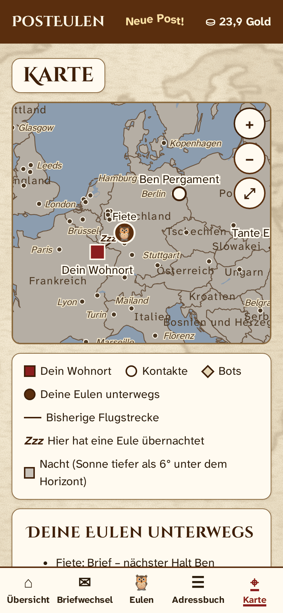
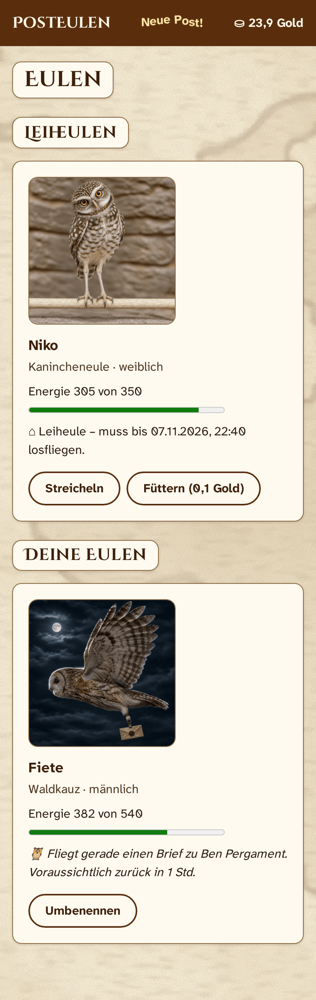

# PostEulen.de 🦉

**Letters brought by an owl.** A running instance lives at **[posteulen.de](https://posteulen.de)** – do drop by.

🇩🇪 *Diese README auf Deutsch: [README.md](README.md)*

> The name *PostEulen* is German for “post owls”. The app speaks German and English: tap the little British flag in the top right corner and everything – menus, help, system messages and even the bots’ letters – switches to English.

---

## Part 1: For everyone who likes getting post

<p align="center">
  
</p>

Remember how lovely it was to find a real letter in the letter box? PostEulen brings that feeling back. Your messages do not dash through the net in milliseconds; they are brought by an owl – and the owl, being an owl, has a mind of its own: depending on distance, time of day and fitness, it is on its way for a few hours. It prefers flying at night (less tiring), it bravely keeps going over the sea, and when it really cannot go on, it takes a nap – just long enough to have the strength for its next destination. You can watch it on the map.

You buy or borrow owls, name them, give them water, pet them and spoil them with owl biscuits or their favourite snack. Seventeen species live in the Menagerie, from the tiny Elf Owl to Blakiston’s Fish Owl – and lately a phoenix that one morning was simply sitting on the window sill. Each of them tells you a little about its character there. Cared-for owls are motivated and then fly faster and further; well looked-after owls also fall ill less often, and with a bit of luck one of them lays eggs one day. While an owl is on its way, the overview shows it flying – in sunshine or under the stars – and on the map it draws a fine trail behind it, with a “Zzz” at every place it spent the night. When it takes a nap on the way, you see it asleep, and when it comes home, it waits for you on the window sill – by day it likes to doze there too; owls are night birds, after all.

You get gold every day (3 gold pieces during your first 30 days, 2 after that), and three pen friends join in: a patient **Explainer Bear**, a chatty **aunt** with a cauldron (she writes to you a few minutes after you sign up) and a wonderfully crazy **uncle** who occasionally inherits an offended goat.

### Game? Messenger? Both – and seriously secure.

PostEulen deliberately lives on the border between game and messenger. The owls are the game. **The encryption is not.** Under the parchment surface works hard, serious, up-to-date cryptography:

- Letters between people are encrypted **on your device** (XChaCha20-Poly1305) and signed (Ed25519). Only sender and recipient get the key, wrapped according to the HPKE standard (RFC 9180).
- Your **password never leaves your device.** Signing in uses OPAQUE (RFC 9807) – the server can neither see your password nor guess it from a stolen database.
- A **safety number** shows you that nobody is sitting in between.
- No adverts, no tracking, no stored IP addresses, no content from other servers.

So PostEulen is quite suitable as a secure way of communicating – as long as minutes do not matter. What it cannot hide: *who* writes to *whom* and *when*. And anyone holding your unlocked phone can of course read along. That is not the owl’s fault.

### Good to know

- **Letters do not last for ever.** All letters are deleted automatically and for good **one year** after delivery at the latest. If you like, set 30, 90 or 180 days in the settings. Anything you want to keep is best copied out – like in the old days.
- **Forgotten password means: account gone.** Nobody can reset it, not even the operator. That is not a bug; it is the price of real encryption.
- **Letters have room:** a small letter holds 800 characters and is free, a large parchment 15,000 characters.
- **One owl, many friends:** your own owls and loan owls fly to up to five recipients one after another – on the shortest route.
- **German or English:** a little flag in the top right corner switches the whole app to English (and back). Accounts remember their language; the pen friends then write in English too.
- **PostEulen is free** – no adverts, no paywall. Every five weeks a small system message asks, with a wink, for a voluntary donation via [ko-fi.com/posteulen](https://ko-fi.com/posteulen); the “Donate” link is also at the bottom of the start page. Nobody has to, everybody may.

### A good first messenger for children

PostEulen is also a great way to introduce children gently to messengers:

- **No pull, no constant availability.** Letters take hours to arrive. Nobody waits for an instant reply, and there is nothing that tempts you to keep checking – the owl arrives when it arrives.
- **No strangers.** Only people who have entered each other with the exact name in the address book can write. There is no search for other users, and requests from strangers are invisible. This way parents keep track of who can write to their child.
- The three pen friends Explainer Bear, aunt and uncle reply using AI (their letters are not encrypted and are sent to OpenAI to be answered). If you do not want that, remove them with one tap in the address book.

### How does PostEulen get onto your phone? Without an app store!

You get apps from the app store, right? Usually, yes. PostEulen is deliberately not there – and still it becomes a real app with its own owl icon. The trick: some websites can turn into an app (experts say “Progressive Web App”, but you may forget the term straight away). You simply put it on your home screen. Nothing is installed secretly, the app wants neither your photos nor your contacts, and updates arrive by themselves.

- **Android with Chrome:** open [posteulen.de](https://posteulen.de) → tap the three dots ⋮ in the top right corner → “Add to Home screen” → “Install” (sometimes it is simply called “Install app”).
- **iPhone or iPad with Safari:** open [posteulen.de](https://posteulen.de) → share icon (square with an arrow; on newer iPhones behind the three dots ••• at the bottom right) → “Add to Home Screen” → “Add”. After that, always open PostEulen with the new icon.
- **All other phones, Firefox and computers:** simply add a bookmark to your home screen or use it in the browser as usual. Everything works the same.

The only difference: notifications (“An owl has landed!”) are only available in the app on the home screen of Android/Chrome and iPhone/Safari. In the browser your post arrives anyway – you see it the next time you look in. In real life the letter box does not ring either. 😉

**Special case: Android without Google services** (LineageOS, GrapheneOS, /e/OS …): Chrome and its relatives deliver notifications only via Google services. Without them it works with **IronFox** or **Fennec** (from F-Droid) plus a **UnifiedPush** app such as **Sunup** or **ntfy**: in IronFox go to Settings → IronFox settings → Miscellaneous, turn on “Use UnifiedPush”, restart the browser and allow notifications for PostEulen (Privacy and security → Site settings → Permissions → Notifications → “Ask to allow”). On GrapheneOS, “Sandboxed Google Play” with Chrome is an alternative. The detailed help in the app explains this step by step.

The help in the app explains everything else, and the Explainer Bear answers questions by letter.

<p align="center">
  
  &nbsp;
  
  &nbsp;
  
</p>

PostEulen is a hobby project, put together out of curiosity, parchment and a healthy dose of love for owls.

---

## Part 2: For everyone who would like to run their own owlery

You want to open your own owlery? Go ahead. This guide explains step by step how to run PostEulen on your own server (VPS) with **Debian 13** over HTTPS. It is written for beginners; every step of the scripts is explained so you could also do it by hand if necessary. Owls are not included – the software creates them.

The scripts and the admin panel speak German; the commands below are the same in any language.

Version: **0.5.1**.

**In short**

1. Prepare server and domain ([section 1](#1-requirements)).
2. One command installs everything ([section 2](#2-installation-with-one-command)).
3. Back up the secrets file and the backup key outside the server ([sections 2](#2-installation-with-one-command) and [5](#5-backups-and-restoring)).
4. In the admin panel: change the password, open registration, enter the OpenAI key ([section 3](#3-first-login-to-the-admin-panel)).
5. Adapt the privacy policy and imprint to your own instance ([section 9](#9-privacy-policy-and-imprint)).

### 1. Requirements

- A VPS with a freshly installed Debian 13 (amd64 or arm64). At least 1 GB of RAM (2 GB recommended), 1 CPU core, 10 GB of storage. With less than 2 GB of RAM the script offers to create a swap file so that the build does not fail.
- Your own domain, e.g. `posteulen.de`.
- Two DNS records (A for IPv4, plus AAAA for IPv6 if available) pointing to the server’s address:

  ```
  posteulen.de        →  IP of the server
  admin.posteulen.de  →  IP of the server
  ```

  Without these records Caddy cannot get HTTPS certificates from Let’s Encrypt.
- SSH access to the server, ideally with an SSH key instead of a password. You store the key from your own computer with `ssh-copy-id user@server`. Only then does the installation script offer to switch off password login.
- For the bots, an OpenAI API key (<https://platform.openai.com>). Without a key everything else works; the bots just do not reply – they only send their fixed letters.

### 2. Installation with one command

On the server, as a normal user with sudo rights (or as root):

```bash
sudo apt update && sudo apt install -y git
git clone https://github.com/diplomendstadium/posteulen.git posteulen
sudo ./posteulen/deploy/install.sh --domain posteulen.de
```

The script only asks what is necessary. All questions can also be answered with parameters (overview: `sudo ./posteulen/deploy/install.sh --help`). It does the following:

1. It checks the system: Debian 13, root rights, architecture, RAM, free storage, whether ports 80 and 443 are free and whether the DNS records point to this server (only a warning if they do not).
2. It sets up two package sources with verified signing keys: Node.js 26 (NodeSource) and Caddy (official Caddy source). This way their security updates also arrive via apt. The key fingerprints are fixed in the script (`deploy/lib.sh`); if one does not match, the script stops.
3. Basic hardening:
   - Firewall (ufw): only 22/tcp (SSH), 80/tcp, 443/tcp and 443/udp (HTTP/3) are open.
   - Automatic security updates (unattended-upgrades), also for Node.js and Caddy; affected services are restarted automatically afterwards (needrestart).
   - SSH with keys only: only after asking and only if a key is already stored for the logged-in user (protection against locking yourself out).
4. It creates the system user `posteulen` and these directories:

   | Path | Content |
   |---|---|
   | `/opt/posteulen/repo` | copy of the Git repository (for updates) |
   | `/opt/posteulen/releases/…` | built versions (the last 3 are kept) |
   | `/opt/posteulen/current` | link to the running version |
   | `/var/lib/posteulen` | database (readable only by the service) |
   | `/var/backups/posteulen` | encrypted backups |
   | `/etc/posteulen` | configuration and secrets file |
   | `/etc/posteulen/local` | your own adjustments (never overwritten) |

   Then it builds the software, creates the secrets file `/etc/posteulen/secrets.json` once, sets up the database and writes the Caddyfile, the hardened systemd service `posteulen` and the backup timer.
5. It starts everything and checks over HTTPS that website, admin panel, health endpoint and security headers work.
6. At the end it shows a summary and a big note about backups.

> [!CAUTION]
> **Back up the file `/etc/posteulen/secrets.json` outside the server immediately** (e.g. with scp to your own computer, and keep it encrypted there):
>
> ```bash
> scp root@posteulen.de:/etc/posteulen/secrets.json ./posteulen-secrets.json
> ```
>
> **WITHOUT THIS FILE NOBODY CAN SIGN IN AFTER A SERVER FAILURE.** Among other things it contains the secret key for signing in (OPAQUE). The database alone is useless without it – on purpose: anyone who only steals the database cannot use it to try out passwords.

The script may be run again as often as you like. It then repairs or completes things, but never changes the secrets file, database, backups or files in `/etc/posteulen/local`.

Test mode (e.g. in a VM without a public domain): `--test-mode` uses local certificates from Caddy instead of Let’s Encrypt and skips the DNS check.

### 3. First login to the admin panel

- At the end of the installation (or of the update that added the admin panel) the initial admin password is shown once. Use it to sign in at `https://admin.posteulen.de`.
- At the first login it must be changed (at least 15 characters); nothing else is possible before that.
- Choose the registration mode: “geschlossen” (closed, default), “nur mit Einladungscode” (invitation code only) or “offen für alle” (open to everyone). Invitation codes are valid for 48 hours, can be used once and are only shown when created.
- The error log shows understandable entries (without personal data) for 30 days.
- Statistics: accounts created, existing and active, and letters (daily counters only).
- Deletion period for inactivity: default 180 days, at least 60. Those affected are warned 30 days before; even shortening the period deletes nobody without this warning.
- Message to everyone: appears in the system chat of all accounts, with a notification.
- OpenAI (bots): enter the API key (stored encrypted and never shown again), choose the model (default “gpt-6-luna”; “Modelle von OpenAI laden” or by hand), daily limit (default 200 calls), “Verbindung testen” (test connection). Without a key the bots send their fixed letters but answer nothing; waiting replies are sent right after a key has been entered. The server needs outgoing connections to `api.openai.com` (port 443) for this. The bots reply in the language of each account.
- Forgotten the admin password? On the server, `sudo posteulen-cli admin-reset` creates a new initial password and signs out all admin sessions. User data stays untouched.

### 4. Functional test

Open `https://posteulen.de` in the browser, create an account (open registration in the admin panel first or create an invitation code), sign out and sign in again. Pair with a second account (both add each other in the address book) and send a letter – without an owl of your own, the owl choice offers a loan owl of the day straight away (0.1 gold). The owl flies in real time (25 km/h times the species factor): if both live close together, it arrives within minutes, otherwise within hours. Patience is a feature here.

On the server, `sudo posteulen-cli check` shows whether the database and the secrets file belong together.

### 5. Backups and restoring

- Every day at 02:30 UTC a systemd timer backs up the database: consistently (even while running) and encrypted with `age`. Only the public key is stored on the server for this (`/etc/posteulen/backup.pub`). Backups are deleted after 7 days – so deleted data also disappears from the backups after 7 days at the latest. Back up right now: `sudo systemctl start posteulen-backup.service`
- Private backup key: if you passed `--backup-pubkey age1…` during installation, you already have it. Otherwise the script put it into `/root/posteulen-backup-schluessel.txt`: back this file up outside the server and then delete it on the server.
- A copy of the backups belongs outside the server, e.g. fetched every day from another computer:

  ```bash
  rsync -a --delete root@posteulen.de:/var/backups/posteulen/ ./posteulen-backups/
  ```

  Keep them there for at most 7 days as well (`rsync --delete` takes care of that).
- Keep the secrets file and the private backup key safe and separate, once.

**Restore A – on the same server** (e.g. after an operating mistake): continue with step 2 below. The secrets file is still there.

**Restore B – after a total failure, on a new server:** you need the three things that should be backed up outside the server: `posteulen-secrets.json`, `posteulen-backup-schluessel.txt` and a backup (`posteulen-…-taeglich.sqlite.age`). Copy all three to the new server with scp, e.g. to `/root`.

1. **Before** installing, put the secrets file back. The script then takes it over (it never overwrites it) and sets the right permissions:

   ```bash
   sudo install -d -m 0700 /etc/posteulen
   sudo install -m 0600 posteulen-secrets.json /etc/posteulen/secrets.json
   ```

   Then install as in section 2, but with the previous public backup key. It is in the key file in the line `# public key: age1…`:

   ```bash
   grep 'public key' posteulen-backup-schluessel.txt
   sudo ./posteulen/deploy/install.sh --domain posteulen.de --backup-pubkey age1…
   ```

   This way all future backups also stay readable with the previous key.
2. Decrypt and restore the backup:

   ```bash
   sudo systemctl stop posteulen
   sudo age --decrypt --identity posteulen-backup-schluessel.txt \
        --output /tmp/restore.sqlite posteulen-YYYYMMDDTHHMMSSZ-taeglich.sqlite.age
   sudo rm -f /var/lib/posteulen/posteulen.sqlite-wal /var/lib/posteulen/posteulen.sqlite-shm
   sudo install -m 0600 -o posteulen -g posteulen /tmp/restore.sqlite /var/lib/posteulen/posteulen.sqlite
   sudo rm /tmp/restore.sqlite
   ```

3. Check and start (`migrate` is only needed if the backup is older than the version):

   ```bash
   sudo posteulen-cli migrate
   sudo posteulen-cli check
   sudo systemctl start posteulen
   ```

   `check` reports an error if the secrets file and the database do not belong together.
4. For B: delete the key file and the backup from the new server again (`sudo rm /root/posteulen-backup-schluessel.txt /root/posteulen-*.sqlite.age`). Then sign in with an account and open an old letter.

Everything that happened after the backup used is lost. Users have to sign in again if their session was created after the backup. Owls that were on their way according to the backup land immediately after the start if their arrival time has already passed.

Both ways (A and B) are played through automatically in a Debian 13 VM for every version (`npm run test:vm`).

### 6. Updates

```bash
sudo posteulen-update --check     # shows installed and available version
sudo posteulen-update             # installs the newest version
sudo posteulen-update v0.5.0      # installs a particular version
```

Sequence: fetch the new version → run its update steps → build (the old version keeps running meanwhile) → encrypted backup → stop the service → database migrations → switch over → start → functional check. Downtime is a few minutes at most. Versions may be skipped.

After the first start of a new version, every existing account gets one system message that explains what is new in simple words (without a push notification). Anyone skipping versions gets the messages of all skipped versions. A fresh installation sends nothing. The texts are in `shared/src/texts/messages.ts` (German and English); every new version gets a new entry there. The message appears in the language the user currently has set.

In addition, every account gets a friendly request for a voluntary donation to the project ([ko-fi.com/posteulen](https://ko-fi.com/posteulen)) every five weeks after registration, three texts in turn. This is part of the project and the same on every instance.

Optionally, `--verify-tags` checks the signature of the version against the keys in `deploy/allowed_signers` (versions are signed by the project maintainer).

If an update goes wrong: the script automatically goes back to the previous version and restores the database snapshot taken just before. It explains what happened. Please report the error with the output of `journalctl -u posteulen -n 100`.

Going back to the previous version afterwards (everything created since the update is lost!):

```bash
sudo posteulen-update --rollback
```

For the automatic rollback, an additional unencrypted snapshot is kept in `/var/lib/posteulen/snapshots` before every update (protected just like the database itself); it is also deleted after 7 days.

### 7. Logs and common errors

```bash
journalctl -u posteulen -n 100    # backend
journalctl -u caddy -n 100        # web server/HTTPS
systemctl status posteulen
```

The logs deliberately contain no IP addresses, no names and no content. The owls keep quiet as well.

- “Geheimnis-Datei fehlt” (secrets file missing): restore the backed-up `secrets.json` ([section 5](#5-backups-and-restoring)).
- “Die Geheimnis-Datei passt nicht zu dieser Datenbank” (secrets file does not match this database): wrong `secrets.json` – restore the file that belongs to the database.
- “Migrationen stehen aus” (migrations pending): `sudo posteulen-cli migrate`
- No HTTPS certificate: check the DNS records ([section 1](#1-requirements)), then `sudo systemctl restart caddy`.
- Bots do not reply: in the admin panel under “OpenAI (Bots)” check key, model and “Verbindung testen”; the error log shows the cause. Replies are retried every 24 hours, immediately after a key has been saved. If the daily limit has been reached, the replies arrive the next day.
- Notifications do not arrive: in the app, send a test notification from the settings. The app’s help explains iPhone and Android without Google services. The server must be able to reach push services on port 443.
- Users see “Please reload”: after an update the app reloads by itself; older tabs get this request instead of an error.
- The app shows “No connection”: is the service running (`systemctl status posteulen`) and is Caddy reachable (`systemctl status caddy`)?
- Old letters are gone: that is on purpose. Letters and system messages are deleted one year after delivery at the latest (every day at 04:00 UTC), or sooner if users choose so.

### 8. Optional

- IP allow list for the admin panel: pass `--admin-allowlist 203.0.113.7/32,2001:db8::/64` during installation or create the file `/etc/posteulen/local/admin-allowlist.caddy`:

  ```
  @nicht_erlaubt not remote_ip 203.0.113.7/32
  respond @nicht_erlaubt 403
  ```

  then: `sudo systemctl reload caddy`
- Your own ntfy server as UnifiedPush server: if you use Android without Google services and do not want a third-party push server, you can run ntfy yourself (<https://docs.ntfy.sh/install/>) and enter it as the server in the ntfy app on the phone. PostEulen needs no setting for this: it sends to any push address the browser reports (HTTPS only, no private addresses).
- Outgoing connections: the server must be able to reach push services over HTTPS (port 443) (Mozilla, Google, Apple, UnifiedPush servers).

### 9. Privacy policy and imprint

The privacy policy (`/datenschutz`) and imprint (`/impressum`) are part of the app as standard texts of the project, in German and English. Anyone running their own instance adapts them to their own operation and is responsible for them. The texts are in `shared/src/texts/legal.ts` (German) and `shared/src/texts/legal-en.ts` (English): change them in your own repository, commit, tag a new version and install it with `sudo posteulen-update`. (Files changed directly on the server are overwritten by the next update.)

If you use the bots, letters to bots are transferred to OpenAI. You may need to conclude OpenAI’s data processing terms (Data Processing Addendum) for this.

### Appendix: Local development

Requirement: Node.js 26 (e.g. from <https://deb.nodesource.com> or <https://nodejs.org>).

| Command | Effect |
|---|---|
| `npm start` | installs dependencies, builds and starts locally: app <http://localhost:8080>, admin <http://localhost:8081> (initial admin password: `data/admin-erstpasswort.txt`; open registration with `POSTEULEN_PREVIEW_REGISTRATION=open npm start`) |
| `npm run dev` | development mode with automatic reloading (port 5173/5174) |
| `npm test` | all checks and tests |
| `npm run test:vm` | installation and update test in a Debian 13 VM (QEMU/KVM) |

Further reading (in German): [SPEC.md](SPEC.md) (full specification), [ARCHITECTURE.md](ARCHITECTURE.md), [DECISIONS.md](DECISIONS.md), [SECURITY-REVIEW.md](SECURITY-REVIEW.md), [CHANGELOG.md](CHANGELOG.md).
