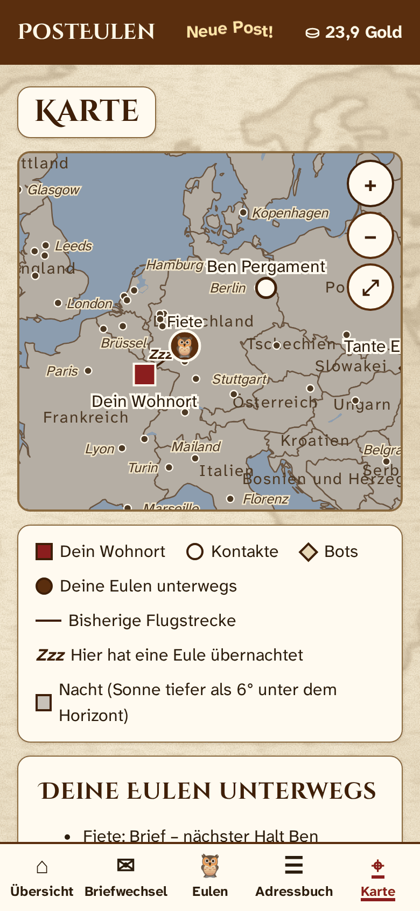
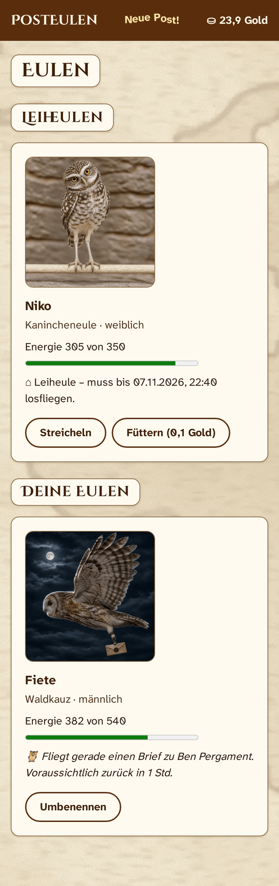

# PostEulen.de 🦉

**Briefe, die eine Eule bringt.** Eine laufende Instanz wohnt unter **[posteulen.de](https://posteulen.de)** – schau gern vorbei.

🇬🇧 *This README in English: [README.en.md](README.en.md)*

---

## Teil 1: Für alle, die gern Post bekommen

<p align="center">
  
</p>

Weißt du noch, wie schön es war, einen richtigen Brief im Kasten zu haben? PostEulen holt dieses Gefühl zurück. Deine Nachrichten flitzen nicht in Millisekunden durchs Netz, sondern werden von einer Eule gebracht – und die hat, ganz Eule, ihren eigenen Kopf: Je nach Entfernung, Tageszeit und Kondition ist sie ein paar Stunden unterwegs. Nachts fliegt sie lieber (weniger anstrengend), über dem Meer hält sie tapfer durch, und wenn sie gar nicht mehr kann, macht sie zehn Stunden Nickerchen. Auf der Karte kannst du ihr dabei zusehen.

Du kaufst oder leihst dir Eulen, gibst ihnen Namen, fütterst und streichelst sie. Siebzehn Arten wohnen in der Menagerie, vom winzigen Elfenkauz bis zum Riesenfischuhu, und jede erzählt dort ein bisschen über ihren Charakter. Gut umsorgte Eulen werden seltener krank, und mit etwas Glück legt eine eines Tages Eier. Ist eine Eule unterwegs, siehst du sie in der Übersicht fliegen – im Sonnenschein oder unter Sternen –, und auf der Karte zieht sie eine feine Spur mit einem „Zzz“ an jedem Übernachtungsort hinter sich her. Kommt sie heim, wartet sie auf dem Fensterbrett.

Gold gibt es jeden Tag (in den ersten 30 Tagen 3 Goldstücke, danach 2), und drei Brieffreunde sind mit von der Partie: ein geduldiger **Erklärbär**, eine plauderfreudige **Tante** mit Zauberkessel (sie schreibt dir ein paar Minuten nach der Anmeldung) und ein herrlich verrückter **Onkel**, der gelegentlich eine beleidigte Ziege erbt.

### Spiel? Messenger? Beides – und zwar ernsthaft sicher.

PostEulen bewegt sich bewusst im Grenzbereich zwischen Spiel und Messenger. Die Eulen sind Spiel. **Die Verschlüsselung ist es nicht.** Unter der Pergamentoberfläche arbeitet harte, seriöse Kryptografie auf dem Stand der Zeit:

- Briefe zwischen Menschen werden **auf deinem Gerät** verschlüsselt (XChaCha20-Poly1305) und unterschrieben (Ed25519). Den Schlüssel bekommen nur Absender und Empfänger, verpackt nach dem Standard HPKE (RFC 9180).
- Dein **Passwort verlässt nie dein Gerät.** Die Anmeldung läuft über OPAQUE (RFC 9807) – der Server kann dein Passwort weder sehen noch aus einer gestohlenen Datenbank erraten.
- Eine **Sicherheitsnummer** zeigt euch, dass niemand dazwischensitzt.
- Keine Werbung, kein Tracking, keine gespeicherten IP-Adressen, keine Inhalte von fremden Servern.

PostEulen taugt also durchaus als sicherer Kommunikationsweg – solange es nicht auf Minuten ankommt. Was es nicht verbergen kann: *wer* wem *wann* schreibt. Und wer dein entsperrtes Handy in der Hand hält, kann natürlich mitlesen. Das liegt nicht an der Eule.

### Gut zu wissen

- **Briefe sind vergänglich.** Alle Briefe werden spätestens **ein Jahr** nach der Zustellung automatisch und unwiderruflich gelöscht. Wer mag, stellt in den Einstellungen 30, 90 oder 180 Tage ein. Was bleiben soll, schreibt man sich besser ab – wie früher.
- **Passwort vergessen heißt: Konto weg.** Niemand kann es zurücksetzen, auch der Betreiber nicht. Das ist kein Fehler, das ist der Preis echter Verschlüsselung.
- **Briefe haben Platz:** Ein kleiner Brief fasst 800 Zeichen und ist kostenlos, ein großes Pergament 15.000 Zeichen.
- **Eine Eule, viele Freunde:** Eigene Eulen und Leiheulen fliegen bis zu fünf Empfänger nacheinander an – auf dem kürzesten Weg.
- **Deutsch oder Englisch:** Ein kleines Fähnchen oben rechts stellt die ganze App auf Englisch um (und wieder zurück). Konten merken sich ihre Sprache; auch die Brieffreunde schreiben dann auf Englisch.
- **PostEulen ist kostenlos** – ohne Werbung, ohne Bezahlschranke. Alle fünf Wochen bittet eine kleine Systemnachricht augenzwinkernd um eine freiwillige Spende über [ko-fi.com/posteulen](https://ko-fi.com/posteulen); der Link „Spenden“ steht auch unten auf der Startseite. Niemand muss, alle dürfen.

### Ein guter erster Messenger für Kinder

PostEulen eignet sich auch prima, um Kinder behutsam an Messenger heranzuführen:

- **Kein Sog, keine Dauerbereitschaft.** Briefe sind Stunden unterwegs. Niemand wartet auf eine Sofortantwort, und es gibt nichts, das zum ständigen Nachsehen verleitet – die Eule kommt, wann sie kommt.
- **Keine Fremden.** Schreiben kann nur, wer sich gegenseitig mit dem genauen Namen im Adressbuch eingetragen hat. Eine Suche nach anderen gibt es nicht, und Anfragen Unbekannter sind unsichtbar. Eltern behalten so den Überblick, wer ihrem Kind schreiben kann.
- Die drei Brieffreunde Erklärbär, Tante und Onkel antworten per KI (ihre Briefe sind nicht verschlüsselt und gehen zum Beantworten an OpenAI). Wer das nicht möchte, entfernt sie mit einem Tipp im Adressbuch.

### Wie kommt PostEulen aufs Handy? Ganz ohne App-Store!

Apps holt man sich im App-Store, oder? Meistens schon. PostEulen gibt es dort aber absichtlich nicht – und trotzdem wird es eine richtige App mit eigenem Eulen-Symbol. Der Trick: Manche Webseiten können sich in eine App verwandeln (Fachleute sagen „Progressive Web App“, das Wort darf man aber sofort wieder vergessen). Man legt sie einfach auf den Startbildschirm. Es wird nichts heimlich installiert, die App will weder Fotos noch Telefonbuch, und Updates kommen von selbst.

- **Android mit Chrome:** [posteulen.de](https://posteulen.de) öffnen → oben rechts auf die drei Punkte ⋮ → „Zum Startbildschirm hinzufügen“ → „Installieren“ (manchmal heißt es direkt „App installieren“).
- **iPhone oder iPad mit Safari:** [posteulen.de](https://posteulen.de) öffnen → Teilen-Symbol (Quadrat mit Pfeil; bei neueren iPhones hinter den drei Punkten ••• unten rechts) → „Zum Home-Bildschirm“ → „Hinzufügen“. Danach PostEulen immer über das neue Symbol öffnen.
- **Alle anderen Handys, Firefox und der Computer:** einfach als Lesezeichen auf den Startbildschirm legen oder ganz normal im Browser benutzen. Alles funktioniert genauso.

Der einzige Unterschied: Benachrichtigungen („Eine Eule ist gelandet!“) gibt es nur in der App auf dem Startbildschirm von Android/Chrome und iPhone/Safari. Im Browser kommt die Post trotzdem an – man sieht sie beim nächsten Hineinschauen. Im echten Leben klingelt der Briefkasten ja auch nicht. 😉

**Sonderfall Android ohne Google-Dienste** (LineageOS, GrapheneOS, /e/OS …): Chrome und seine Verwandten liefern Benachrichtigungen nur über Google-Dienste. Ohne sie klappt es mit **IronFox** oder **Fennec** (aus F-Droid) plus einer **UnifiedPush**-App wie **Sunup** oder **ntfy**: In IronFox unter Einstellungen → IronFox-Einstellungen → Verschiedenes „Use UnifiedPush“ einschalten, Browser neu starten und Benachrichtigungen für PostEulen erlauben (Datenschutz und Sicherheit → Website-Einstellungen → Berechtigungen → Benachrichtigungen → „Erlauben erfragen“). Unter GrapheneOS geht alternativ „Sandboxed Google Play“ mit Chrome. Die ausführliche Hilfe in der App erklärt das Schritt für Schritt.

Die Hilfe in der App erklärt alles Weitere, und der Erklärbär beantwortet Fragen per Brief.

<p align="center">
  
  &nbsp;
  
  &nbsp;
  
</p>

PostEulen ist ein Hobbyprojekt, gebastelt aus Neugier, Pergament und einer gesunden Portion Eulenliebe.

---

## Teil 2: Für alle, die selbst einen Eulenschlag betreiben möchten

Du willst deine eigene Eulerei aufmachen? Sehr gern. Diese Anleitung erklärt Schritt für Schritt, wie PostEulen auf einem eigenen Server (VPS) mit **Debian 13** per HTTPS läuft. Sie ist für Einsteiger geschrieben; jeder Schritt der Skripte ist erklärt, damit man ihn notfalls auch von Hand ausführen kann. Eulen sind nicht im Lieferumfang enthalten, die erzeugt die Software.

Stand: **Version 0.4.0**.

**Kurzfassung**

1. Server und Domain vorbereiten ([Abschnitt 1](#1-voraussetzungen)).
2. Ein Befehl installiert alles ([Abschnitt 2](#2-installation-mit-einem-befehl)).
3. Geheimnis-Datei und Backup-Schlüssel außerhalb des Servers sichern ([Abschnitte 2](#2-installation-mit-einem-befehl) und [5](#5-sicherungen-backups-und-wiederherstellung)).
4. Im Adminpanel Passwort ändern, Registrierung öffnen, OpenAI-Key eintragen ([Abschnitt 3](#3-erster-login-im-adminpanel)).
5. Datenschutzerklärung und Impressum an die eigene Instanz anpassen ([Abschnitt 9](#9-datenschutzerklärung-und-impressum)).

### 1. Voraussetzungen

- Ein VPS mit frisch installiertem Debian 13 (amd64 oder arm64). Mindestens 1 GB Arbeitsspeicher (2 GB empfohlen), 1 CPU-Kern, 10 GB Speicher. Bei weniger als 2 GB Arbeitsspeicher legt das Skript nach Rückfrage eine Swap-Datei an, damit der Build nicht abbricht.
- Eine eigene Domain, z. B. `posteulen.de`.
- Zwei DNS-Einträge (A für IPv4, zusätzlich AAAA für IPv6, falls vorhanden), die auf die Adresse des Servers zeigen:

  ```
  posteulen.de        →  IP des Servers
  admin.posteulen.de  →  IP des Servers
  ```

  Ohne diese Einträge kann Caddy keine HTTPS-Zertifikate von Let's Encrypt bekommen.
- SSH-Zugang zum Server, am besten mit einem SSH-Schlüssel statt Passwort. Den Schlüssel hinterlegt man auf dem eigenen Rechner mit `ssh-copy-id benutzer@server`. Erst dann bietet das Installations-Skript an, die Anmeldung per Passwort abzuschalten.
- Für die Bots ein OpenAI-API-Key (<https://platform.openai.com>). Ohne Key läuft alles andere, nur antworten die Bots nicht – sie schreiben dann bloß ihre festen Briefe.

### 2. Installation mit einem Befehl

Auf dem Server als normaler Benutzer mit sudo-Rechten (oder als root):

```bash
sudo apt update && sudo apt install -y git
git clone https://github.com/diplomendstadium/posteulen.git posteulen
sudo ./posteulen/deploy/install.sh --domain posteulen.de
```

Das Skript fragt nur das Nötigste. Alle Fragen lassen sich auch per Parameter beantworten (Übersicht: `sudo ./posteulen/deploy/install.sh --help`). Es macht Folgendes:

1. Es prüft das System: Debian 13, root-Rechte, Architektur, Arbeitsspeicher, freien Speicher, ob die Ports 80 und 443 frei sind und ob die DNS-Einträge auf diesen Server zeigen (bei Abweichung nur eine Warnung).
2. Es richtet zwei Paketquellen mit geprüften Signaturschlüsseln ein: Node.js 26 (NodeSource) und Caddy (offizielle Caddy-Quelle). So kommen auch deren Sicherheitsupdates über apt. Die Fingerabdrücke der Schlüssel stehen fest im Skript (`deploy/lib.sh`); passt einer nicht, bricht das Skript ab.
3. Grundabsicherung:
   - Firewall (ufw): nur 22/tcp (SSH), 80/tcp, 443/tcp und 443/udp (HTTP/3) sind offen.
   - Automatische Sicherheitsupdates (unattended-upgrades), auch für Node.js und Caddy; betroffene Dienste werden danach automatisch neu gestartet (needrestart).
   - SSH nur noch mit Schlüssel: nur nach Rückfrage und nur, wenn für den angemeldeten Benutzer bereits ein Schlüssel hinterlegt ist (Schutz vor Aussperren).
4. Es legt den Systembenutzer `posteulen` und diese Verzeichnisse an:

   | Pfad | Inhalt |
   |---|---|
   | `/opt/posteulen/repo` | Kopie des Git-Repositorys (für Updates) |
   | `/opt/posteulen/releases/…` | gebaute Versionen (die letzten 3 bleiben erhalten) |
   | `/opt/posteulen/current` | Verweis auf die laufende Version |
   | `/var/lib/posteulen` | Datenbank (nur für den Dienst lesbar) |
   | `/var/backups/posteulen` | verschlüsselte Sicherungen |
   | `/etc/posteulen` | Konfiguration und Geheimnis-Datei |
   | `/etc/posteulen/local` | eigene Anpassungen (werden nie überschrieben) |

   Dann baut es die Software, erzeugt einmalig die Geheimnis-Datei `/etc/posteulen/secrets.json`, legt die Datenbank an und schreibt die Caddyfile, den gehärteten systemd-Dienst `posteulen` und den Sicherungs-Timer.
5. Es startet alles und prüft über HTTPS, dass Website, Adminpanel, Health-Endpunkt und Sicherheits-Header funktionieren.
6. Am Ende zeigt es eine Zusammenfassung und einen großen Hinweis zur Sicherung.

> [!CAUTION]
> **Die Datei `/etc/posteulen/secrets.json` sofort außerhalb des Servers sichern** (z. B. per scp auf den eigenen Rechner und dort verschlüsselt aufbewahren):
>
> ```bash
> scp root@posteulen.de:/etc/posteulen/secrets.json ./posteulen-secrets.json
> ```
>
> **OHNE DIESE DATEI KANN SICH NACH EINEM SERVERAUSFALL NIEMAND MEHR ANMELDEN.** Sie enthält unter anderem den geheimen Schlüssel für die Anmeldung (OPAQUE). Die Datenbank allein nützt ohne sie nichts – das ist Absicht: Wer nur die Datenbank stiehlt, kann damit keine Passwörter durchprobieren.

Das Skript darf beliebig oft erneut ausgeführt werden. Es repariert oder ergänzt dann, ändert aber nie Geheimnis-Datei, Datenbank, Sicherungen oder Dateien in `/etc/posteulen/local`.

Testmodus (z. B. in einer VM ohne öffentliche Domain): `--test-mode` verwendet lokale Zertifikate von Caddy statt Let's Encrypt und überspringt die DNS-Prüfung.

### 3. Erster Login im Adminpanel

- Am Ende der Installation (bzw. des Updates, mit dem das Adminpanel dazukam) steht einmalig das Admin-Erstpasswort. Damit unter `https://admin.posteulen.de` anmelden.
- Beim ersten Login muss es geändert werden (mindestens 15 Zeichen); vorher geht nichts anderes.
- Registrierungsmodus wählen: „geschlossen“ (Standard), „nur mit Einladungscode“ oder „offen für alle“. Einladungscodes sind 48 Stunden gültig, einmal verwendbar und werden nur beim Erzeugen angezeigt.
- Das Fehlerprotokoll zeigt verständliche Einträge (ohne persönliche Daten), 30 Tage lang.
- Statistik: erstellte, vorhandene und aktive Konten sowie Briefe (nur Tageszähler).
- Löschfrist bei Inaktivität: Standard 180 Tage, mindestens 60. Betroffene werden 30 Tage vorher gewarnt; auch eine Verkürzung löscht niemanden ohne diese Warnung.
- Rundnachricht: erscheint im Systemchat aller Konten, mit Benachrichtigung.
- OpenAI (Bots): API-Key eintragen (wird verschlüsselt gespeichert und nie wieder angezeigt), Modell wählen (Standard „gpt-6-luna“; „Modelle von OpenAI laden“ oder von Hand), Tageslimit (Standard 200 Aufrufe), „Verbindung testen“. Ohne Key schreiben die Bots ihre festen Briefe, beantworten aber nichts; wartende Antworten werden nach dem Eintragen sofort nachgeholt. Der Server braucht dafür ausgehende Verbindungen zu `api.openai.com` (Port 443).
- Adminpasswort vergessen? Auf dem Server erzeugt `sudo posteulen-cli admin-reset` ein neues Erstpasswort und meldet alle Admin-Sitzungen ab. Nutzerdaten bleiben unberührt.

### 4. Funktionstest

Im Browser `https://posteulen.de` öffnen, ein Konto anlegen (vorher im Adminpanel die Registrierung öffnen oder einen Einladungscode erzeugen), abmelden und wieder anmelden. Mit einem zweiten Konto koppeln (beide fügen sich im Adressbuch hinzu) und einen Brief schicken – ohne eigene Eule bietet die Eulenwahl direkt eine Leiheule des Tages an (0,1 Gold). Die Eule fliegt in Echtzeit (25 km/h mal Artfaktor): Wohnen beide nah beieinander, ist sie nach Minuten da, sonst nach Stunden. Geduld ist hier ein Feature.

Auf dem Server zeigt `sudo posteulen-cli check`, ob Datenbank und Geheimnis-Datei zusammenpassen.

### 5. Sicherungen (Backups) und Wiederherstellung

- Jeden Tag um 02:30 UTC sichert ein systemd-Timer die Datenbank: konsistent (auch während des Betriebs) und mit `age` verschlüsselt. Auf dem Server liegt dafür nur der öffentliche Schlüssel (`/etc/posteulen/backup.pub`). Sicherungen werden nach 7 Tagen gelöscht – so verschwinden gelöschte Daten spätestens nach 7 Tagen auch aus den Sicherungen. Sofort sichern: `sudo systemctl start posteulen-backup.service`
- Privater Backup-Schlüssel: Wer bei der Installation `--backup-pubkey age1…` angegeben hat, besitzt ihn bereits. Sonst hat das Skript ihn in `/root/posteulen-backup-schluessel.txt` abgelegt: diese Datei außerhalb des Servers sichern und danach auf dem Server löschen.
- Eine Kopie der Sicherungen gehört außerhalb des Servers, z. B. täglich von einem anderen Rechner abgeholt:

  ```bash
  rsync -a --delete root@posteulen.de:/var/backups/posteulen/ ./posteulen-backups/
  ```

  Auch dort höchstens 7 Tage aufbewahren (`rsync --delete` erledigt das).
- Geheimnis-Datei und privaten Backup-Schlüssel einmalig separat und sicher aufbewahren.

**Wiederherstellung A – auf demselben Server** (z. B. nach einem Bedienfehler): weiter mit Schritt 2 unten. Die Geheimnis-Datei ist ja noch da.

**Wiederherstellung B – nach einem Totalausfall auf einem neuen Server:** Gebraucht werden die drei Dinge, die außerhalb des Servers gesichert sein sollten: `posteulen-secrets.json`, `posteulen-backup-schluessel.txt` und eine Sicherung (`posteulen-…-taeglich.sqlite.age`). Alle drei per scp auf den neuen Server kopieren, z. B. nach `/root`.

1. **Vor** der Installation die Geheimnis-Datei zurücklegen. Das Skript übernimmt sie dann (es überschreibt sie nie) und setzt die richtigen Rechte:

   ```bash
   sudo install -d -m 0700 /etc/posteulen
   sudo install -m 0600 posteulen-secrets.json /etc/posteulen/secrets.json
   ```

   Dann wie in Abschnitt 2 installieren, aber mit dem bisherigen öffentlichen Backup-Schlüssel. Er steht in der Schlüsseldatei in der Zeile `# public key: age1…`:

   ```bash
   grep 'public key' posteulen-backup-schluessel.txt
   sudo ./posteulen/deploy/install.sh --domain posteulen.de --backup-pubkey age1…
   ```

   So bleiben auch alle künftigen Sicherungen mit dem bisherigen Schlüssel lesbar.
2. Sicherung entschlüsseln und einspielen:

   ```bash
   sudo systemctl stop posteulen
   sudo age --decrypt --identity posteulen-backup-schluessel.txt \
        --output /tmp/restore.sqlite posteulen-JJJJMMTTTHHMMSSZ-taeglich.sqlite.age
   sudo rm -f /var/lib/posteulen/posteulen.sqlite-wal /var/lib/posteulen/posteulen.sqlite-shm
   sudo install -m 0600 -o posteulen -g posteulen /tmp/restore.sqlite /var/lib/posteulen/posteulen.sqlite
   sudo rm /tmp/restore.sqlite
   ```

3. Prüfen und starten (`migrate` ist nur nötig, wenn die Sicherung älter als die Version ist):

   ```bash
   sudo posteulen-cli migrate
   sudo posteulen-cli check
   sudo systemctl start posteulen
   ```

   `check` meldet einen Fehler, wenn Geheimnis-Datei und Datenbank nicht zusammengehören.
4. Bei B: die Schlüsseldatei und die Sicherung vom neuen Server wieder löschen (`sudo rm /root/posteulen-backup-schluessel.txt /root/posteulen-*.sqlite.age`). Danach mit einem Konto anmelden und einen alten Brief öffnen.

Alles, was nach der verwendeten Sicherung geschah, ist verloren. Nutzer müssen sich neu anmelden, wenn ihre Sitzung nach der Sicherung entstanden ist. Eulen, die laut Sicherung unterwegs waren, landen nach dem Start sofort, wenn ihre Ankunftszeit schon vorbei ist.

Beide Wege (A und B) werden bei jeder Version automatisch in einer Debian-13-VM durchgespielt (`npm run test:vm`).

### 6. Updates

```bash
sudo posteulen-update --check     # zeigt installierte und verfügbare Version
sudo posteulen-update             # spielt die neueste Version ein
sudo posteulen-update v0.3.0      # spielt eine bestimmte Version ein
```

Ablauf: neue Version holen → deren Update-Schritte ausführen → bauen (die alte Version läuft währenddessen weiter) → verschlüsselte Sicherung → Dienst stoppen → Datenbank-Migrationen → umschalten → starten → Funktionsprüfung. Die Ausfallzeit beträgt höchstens wenige Minuten. Versionen dürfen übersprungen werden.

Nach dem ersten Start einer neuen Version bekommt jedes bestehende Konto einmal eine Systemnachricht, die die Neuerungen in einfachen Worten erklärt (ohne Push-Benachrichtigung). Wer Versionen überspringt, bekommt die Nachrichten aller übersprungenen Versionen. Eine frische Installation verschickt nichts. Die Texte stehen in `shared/src/texts/messages.ts` (Deutsch und Englisch); zu jeder neuen Version gehört dort ein neuer Eintrag. Die Nachricht erscheint in der Sprache, die der Nutzer gerade eingestellt hat.

Außerdem bekommt jedes Konto alle fünf Wochen nach der Registrierung eine freundliche Bitte um eine freiwillige Spende an das Projekt ([ko-fi.com/posteulen](https://ko-fi.com/posteulen)), drei Texte reihum. Das gehört zum Projekt und ist auf jeder Instanz gleich.

Optional prüft `--verify-tags` die Signatur der Version gegen die Schlüssel in `deploy/allowed_signers` (Versionen werden vom Projektverantwortlichen signiert).

Wenn ein Update schiefgeht: Das Skript kehrt automatisch zur vorherigen Version zurück und spielt die unmittelbar davor gemachte Momentaufnahme der Datenbank ein. Es erklärt, was passiert ist. Den Fehler bitte mit der Ausgabe von `journalctl -u posteulen -n 100` melden.

Nachträglich zurück zur vorigen Version (alles, was seit dem Update entstanden ist, geht verloren!):

```bash
sudo posteulen-update --rollback
```

Für den automatischen Rückfall bleibt vor jedem Update zusätzlich eine unverschlüsselte Momentaufnahme in `/var/lib/posteulen/snapshots` (gleich geschützt wie die Datenbank selbst); auch sie wird nach 7 Tagen gelöscht.

### 7. Logs und häufige Fehler

```bash
journalctl -u posteulen -n 100    # Backend
journalctl -u caddy -n 100        # Webserver/HTTPS
systemctl status posteulen
```

Die Logs enthalten bewusst keine IP-Adressen, keine Namen und keine Inhalte. Die Eulen schweigen ebenfalls.

- „Geheimnis-Datei fehlt“: die gesicherte `secrets.json` zurückspielen ([Abschnitt 5](#5-sicherungen-backups-und-wiederherstellung)).
- „Die Geheimnis-Datei passt nicht zu dieser Datenbank“: falsche `secrets.json` – die zur Datenbank gehörende Datei zurückspielen.
- „Migrationen stehen aus“: `sudo posteulen-cli migrate`
- Kein HTTPS-Zertifikat: DNS-Einträge prüfen ([Abschnitt 1](#1-voraussetzungen)), dann `sudo systemctl restart caddy`.
- Bots antworten nicht: Im Adminpanel unter „OpenAI (Bots)“ Key, Modell und „Verbindung testen“ prüfen; das Fehlerprotokoll zeigt die Ursache. Antworten werden alle 24 Stunden erneut versucht, nach dem Speichern eines Keys sofort. Ist das Tageslimit erreicht, kommen die Antworten am nächsten Tag.
- Benachrichtigungen kommen nicht an: In der App unter Einstellungen eine Test-Benachrichtigung schicken. Die Hilfe der App erklärt iPhone und Android ohne Google-Dienste. Der Server muss Push-Dienste über Port 443 erreichen können.
- Nutzer sehen „Bitte neu laden“: Nach einem Update lädt die App selbst neu; ältere Tabs bekommen diese Aufforderung statt eines Fehlers.
- Die App zeigt „Keine Verbindung“: Ist der Dienst gestartet (`systemctl status posteulen`) und Caddy erreichbar (`systemctl status caddy`)?
- Alte Briefe sind weg: Das ist Absicht. Briefe und Systemnachrichten werden spätestens ein Jahr nach der Zustellung gelöscht (täglich um 04:00 UTC), auf Wunsch der Nutzer auch früher.

### 8. Optional

- IP-Freigabeliste für das Adminpanel: bei der Installation `--admin-allowlist 203.0.113.7/32,2001:db8::/64` angeben oder die Datei `/etc/posteulen/local/admin-allowlist.caddy` anlegen:

  ```
  @nicht_erlaubt not remote_ip 203.0.113.7/32
  respond @nicht_erlaubt 403
  ```

  danach: `sudo systemctl reload caddy`
- Eigener ntfy-Server als UnifiedPush-Server: Wer Android ohne Google-Dienste nutzt und keinen fremden Push-Server möchte, kann ntfy selbst betreiben (<https://docs.ntfy.sh/install/>) und in der ntfy-App auf dem Handy als Server eintragen. PostEulen braucht dafür keine Einstellung: Es sendet an jede Push-Adresse, die der Browser meldet (nur HTTPS, keine privaten Adressen).
- Ausgehende Verbindungen: Der Server muss Push-Dienste per HTTPS (Port 443) erreichen können (Mozilla, Google, Apple, UnifiedPush-Server).

### 9. Datenschutzerklärung und Impressum

Datenschutzerklärung (`/datenschutz`) und Impressum (`/impressum`) liegen als Standardtexte des Projekts in der App, auf Deutsch und Englisch. Wer eine eigene Instanz betreibt, passt sie selbst an seinen Betrieb an und ist dafür verantwortlich. Die Texte stehen in `shared/src/texts/legal.ts` (Deutsch) und `shared/src/texts/legal-en.ts` (Englisch): im eigenen Repository ändern, committen, eine neue Version taggen und mit `sudo posteulen-update` einspielen. (Direkt auf dem Server geänderte Dateien überschreibt das nächste Update.)

Wer die Bots nutzt, überträgt Briefe an Bots an OpenAI. Dafür ggf. die Datenverarbeitungsbedingungen von OpenAI (Data Processing Addendum) abschließen.

### Anhang: Lokale Entwicklung

Voraussetzung: Node.js 26 (z. B. aus <https://deb.nodesource.com> oder <https://nodejs.org>).

| Befehl | Wirkung |
|---|---|
| `npm start` | installiert Abhängigkeiten, baut und startet lokal: App <http://localhost:8080>, Verwaltung <http://localhost:8081> (Admin-Erstpasswort: `data/admin-erstpasswort.txt`; Registrierung öffnen mit `POSTEULEN_PREVIEW_REGISTRATION=open npm start`) |
| `npm run dev` | Entwicklungsmodus mit automatischem Neuladen (Port 5173/5174) |
| `npm test` | alle Prüfungen und Tests |
| `npm run test:vm` | Installations- und Update-Test in einer Debian-13-VM (QEMU/KVM) |

Weiterführend: [SPEC.md](SPEC.md) (vollständige Spezifikation), [ARCHITECTURE.md](ARCHITECTURE.md), [DECISIONS.md](DECISIONS.md), [SECURITY-REVIEW.md](SECURITY-REVIEW.md), [CHANGELOG.md](CHANGELOG.md).
